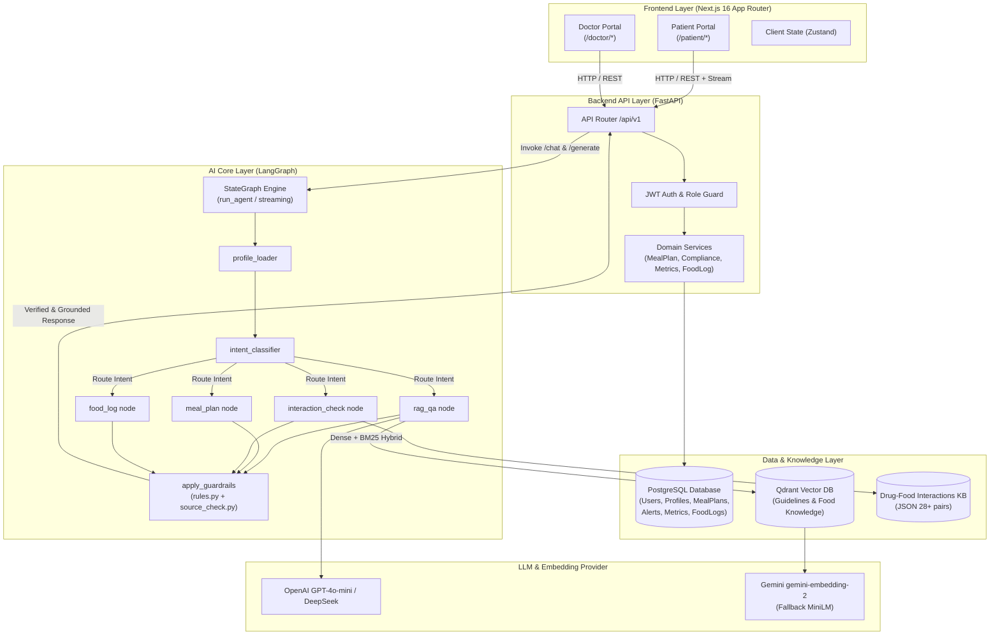
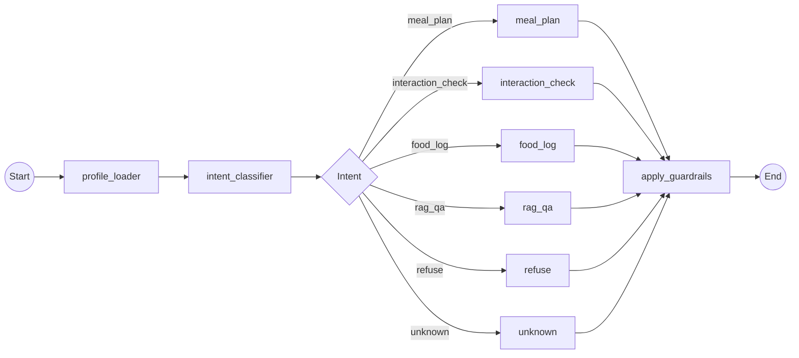
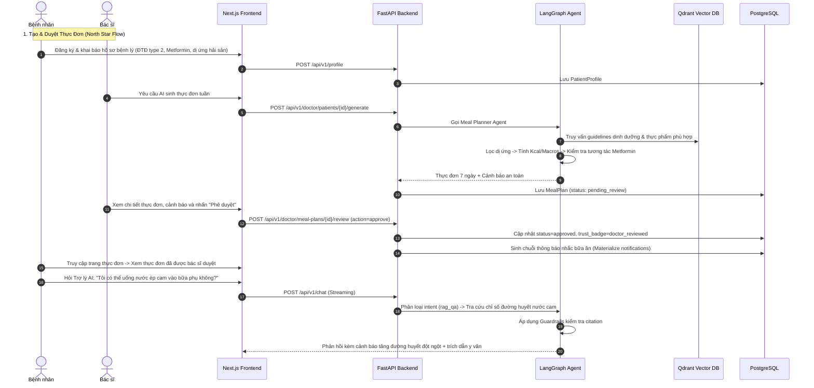
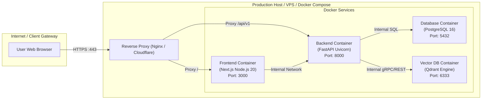

# Architecture Document — VinNutri (P-014)

## System Overview

**VinNutri** là hệ thống AI Agent hỗ trợ tư vấn dinh dưỡng lâm sàng và quản lý lối sống cá nhân hóa cho bệnh nhân mắc các bệnh lý mãn tính (đái tháo đường, tăng huyết áp, gout, bệnh thận). Hệ thống kết hợp quy trình **Human-in-the-Loop (HITL)** bắt buộc: AI tự động phân tích hồ sơ, tìm kiếm phác đồ/guideline y văn thông qua RAG, kiểm tra tương tác thuốc - thực phẩm và sinh thực đơn 7 ngày; bác sĩ/chuyên gia dinh dưỡng giữ quyền kiểm duyệt, phê duyệt và điều chỉnh kế hoạch trước khi ban hành chính thức cho bệnh nhân.

Hệ thống được thiết kế theo kiến trúc 3-Tier hiện đại: Frontend SPA/SSR phân quyền đa vai trò (Bác sĩ & Bệnh nhân), Backend RESTful API hiệu năng cao với FastAPI, và AI Orchestration Core điều phối bởi LangGraph kết hợp Vector Database Qdrant cùng cơ sở dữ liệu quan hệ PostgreSQL.

---

## Architecture Diagram

---

## Components

### 1. Frontend (Next.js 16 + TypeScript + Tailwind CSS)
- **Cấu trúc Routing**: App Router phân tách rõ rệt theo Role:
  - **Portal Bệnh nhân** (`/patient/*`): Dashboard theo dõi chỉ số sức khỏe, xem thực đơn tuần đã được bác sĩ duyệt, nhật ký ghi nhận bữa ăn 3-slot (Food Log), và giao diện Trợ lý AI chat với Generative UI cards.
  - **Portal Bác sĩ** (`/doctor/*`): Hàng đợi duyệt thực đơn AI sinh (`/doctor/queue`), quản lý hồ sơ & ràng buộc lâm sàng bệnh nhân (`/doctor/patients`), xem biểu đồ tuân thủ dinh dưỡng.
- **State Management**: Zustand quản lý authentication token, thông tin phiên đăng nhập và cache dữ liệu client-side.
- **UI Components**: Thiết kế chuẩn mực y tế, tối ưu font chữ, độ tương phản cao, hỗ trợ responsive hoàn toàn trên Desktop và Mobile.

### 2. Backend (FastAPI + Python 3.11+)
- **API Architecture**: RESTful API chuẩn hóa theo hợp đồng [`contracts/api-v1.md`](contracts/api-v1.md), chia tách thành các module rõ ràng: `auth`, `profile`, `meal_plans`, `interactions`, `doctor`, `food_log`, `metrics`, `notifications`.
- **Authentication & Authorization**: Xác thực JWT bearer token, mã hóa mật khẩu bằng `bcrypt`, phân quyền nghiêm ngặt theo vai trò `patient` và `doctor`.
- **Data Validation**: 100% input/output request được kiểm soát chặt chẽ bằng Pydantic v2 schemas theo [`contracts/agent-io-schema.md`](contracts/agent-io-schema.md).

### 3. AI Agent (LangGraph StateGraph)
- **Mô hình điều phối**: StateGraph tuần tự kết hợp Conditional Edge định tuyến thông minh theo ý định người dùng.
- **State Schema**: Quản lý lịch sử hội thoại (`messages`), hồ sơ bệnh nhân (`PatientProfile`), ý định hiện tại (`intent`), ngữ cảnh trích xuất (`retrieved_docs`), danh sách cảnh báo (`alerts`), và cờ an toàn (`safety_flags`).
- **Pipeline Nodes**:
  - `profile_loader`: Nạp thông tin bệnh lý, thuốc đang dùng, dị ứng từ PostgreSQL.
  - `intent_classifier`: Phân loại ý định người dùng (`meal_plan`, `interaction_check`, `food_log`, `rag_qa`, `refuse`, `greeting`, `unknown`) bằng LLM kết hợp Regex keyword fallback.
  - `rag_qa`: Thực hiện Hybrid Search trên Qdrant, tổng hợp câu trả lời tư vấn dinh dưỡng chuẩn y khoa.
  - `interaction_check`: Đối soát tương tác nguy cơ giữa thuốc và thực phẩm với tri thức 3 mức độ nghiêm trọng (*Nguy hiểm, Cần chú ý, An toàn*).
  - `food_log`: Tóm tắt và phân tích nhật ký ăn uống thực tế của bệnh nhân so với kế hoạch.
  - `apply_guardrails`: Node chốt chặn cuối cùng kiểm tra citation, lọc bỏ thông tin tự chẩn đoán hoặc kê đơn sai quy định.

### 4. Database (PostgreSQL)
- **Lưu trữ dữ liệu nghiệp vụ chính thức**:
  - `users`: Tài khoản và phân quyền bác sĩ / bệnh nhân.
  - `patient_profiles`: Hồ sơ bệnh lý (`disease`, `medications`, `allergies`, `target_kcal`, `restrictions`, `preferences`).
  - `meal_plans`: Kế hoạch thực đơn 7 ngày, trạng thái duyệt (`pending_review`, `approved`, `rejected`), thông tin dinh dưỡng và món thay thế.
  - `alerts`: Cảnh báo tương tác thuốc - thức ăn và vi phạm dinh dưỡng.
  - `notifications`: Thông báo tuân thủ, nhắc nhở bữa ăn, kết quả duyệt thực đơn (Event-driven materialized).
  - `food_logs`: Nhật ký ăn uống 3 bữa/ngày và trạng thái tuân thủ thực tế.
  - `body_metrics_history`: Chuỗi thời gian theo dõi chỉ số sức khỏe (cân nặng, BMI, huyết áp, đường huyết).

### 5. Vector Store & RAG Engine (Qdrant)
- **Vector Database**: Qdrant Database chạy độc lập / local persistent (`./qdrant_db`).
- **Embedding Model**: Google Gemini `gemini-embedding-2` (hỗ trợ tiếng Việt xuất sắc), tự động fallback sang local sentence-transformer MiniLM khi thiếu key.
- **Retrieval Strategy**: Hybrid Retrieval kết hợp Dense Vector Similarity và BM25 Keyword Search thông qua thuật toán Reciprocal Rank Fusion (RRF).
- **Knowledge Base**: Guidelines đái tháo đường của Bộ Y tế Việt Nam (QĐ 5481/QĐ-BYT), Hiệp hội Đái tháo đường Hoa Kỳ (ADA), và Bảng thành phần thực phẩm Việt Nam.

### 6. Medical Guardrails & HITL Safety
- **Rule-based Verification (`rules.py`)**: Chặn mọi nỗ lực yêu cầu AI kê đơn thuốc, thay đổi liều lượng điều trị hoặc tự chẩn đoán bệnh lý mới.
- **Source Citation Check (`source_check.py`)**: Mọi số liệu và khuyến nghị dinh dưỡng bắt buộc phải có trích dẫn nguồn y văn rõ ràng; nếu thiếu nguồn, hệ thống tự động từ chối đưa ra kết luận.
- **Human-in-the-Loop (HITL)**: Mọi thực đơn AI sinh ra luôn ở trạng thái `pending_review`. Chỉ khi bác sĩ xem xét và bấm "Duyệt", thực đơn mới được gán huy hiệu tin cậy `trust_badge=doctor_reviewed` và kích hoạt lịch thông báo cho bệnh nhân.

---

## Data Flow (Luồng Dữ Liệu Tiêu Biểu)

---

## Deployment Architecture

---

## Security & Reliability

- **Bảo vệ Secret & API Keys**: Tất cả API key (OpenAI, Gemini, JWT secret) được lưu trữ qua biến môi trường (`.env`), không commit vào Git.
- **Input Validation & Sanitization**: Sử dụng Pydantic v2 để xác thực chặt chẽ kiểu dữ liệu, chặn SQL injection và XSS.
- **Phân quyền vai trò (Role-based Access Control)**: Middleware backend kiểm tra role `doctor` đối với các thao tác phê duyệt, chỉnh sửa ràng buộc y khoa và role `patient` đối với nhật ký cá nhân.
- **Logging & Monitoring**: Tích hợp auto-logging hệ thống và cơ chế logging AI usage phục vụ kiểm thử và đánh giá minh bạch.

---

## Key Design Decisions (ADR Summary)

| Decision | Choice | Rationale | Tham chiếu |
|---|---|---|---|
| **Vector Store** | Qdrant | Hỗ trợ hybrid search mượt mà, lưu trữ cục bộ persistent, chi phí tối ưu hơn Pinecone | [ADR-001](adrs/001-vector-database-choice.md) |
| **Agent Orchestration** | LangGraph | Hỗ trợ StateGraph tuần tự, kiểm soát chặt chẽ luồng rẽ nhánh y tế và Guardrails | [ADR-002](adrs/002-agent-orchestration-langgraph.md) |
| **Embedding Model** | Gemini `gemini-embedding-2` | Hiểu ngữ nghĩa tiếng Việt y tế tốt, có fallback local MiniLM | [ADR-003](adrs/003-embedding-model-choice.md) |
| **LLM Provider** | OpenAI GPT-4o-mini / DeepSeek | Cân bằng giữa chi phí, tốc độ và độ chính xác phân loại intent | [ADR-004](adrs/004-llm-provider-and-fallback-strategy.md) |
| **Database** | PostgreSQL | Toàn vẹn dữ liệu quan hệ, ACID cho hồ sơ y tế và lịch sử tuân thủ | [ADR-005](adrs/005-database-choice.md) |
| **HITL & Guardrails** | Strict Doctor Approval + Citation Guard | Đảm bảo an toàn bệnh nhân, tuân thủ nguyên tắc y khoa không kê đơn tùy tiện | [ADR-006](adrs/006-hitl-guardrails-strategy.md) |
| **Notification Engine** | Event-Driven Materialize-Ahead | Tối ưu tài nguyên, không phụ thuộc cronjob phức tạp trên server free-tier | [ADR-007](adrs/007-compliance-notification-strategy.md) |
| **Food Log Scope** | Structured 3-Slot Manual Entry | Đơn giản, thực tế, dễ đối soát với thực đơn 7 ngày của bệnh nhân | [ADR-009](adrs/009-food-log-scope-strategy.md) |
| **Patient Metrics** | Time-series Body Metrics History | Hỗ trợ biểu đồ trực quan hóa tiến trình đường huyết, huyết áp, cân nặng | [ADR-013](adrs/013-patient-metrics-time-series.md) |
