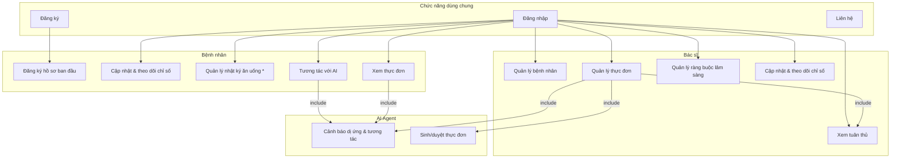

# Mô tả chức năng — VMEC-10 (P-014)

> Tài liệu này chuyển hoá sơ đồ Use Case + bảng tác nhân trong `UML_VinMec_10.docx` thành đặc tả chức năng chi tiết, có luồng hoạt động (step-by-step) cho từng use case, để AI coding agent hoặc dev đọc và triển khai trực tiếp.
> Đối chiếu với repo hiện tại: `CLAUDE.md` (nguồn sự thật stack + MoSCoW), `specs/01-06` (đặc tả as-built của 6 khu vực đã code), `contracts/api-v1.md` + `agent-io-schema.md`.
> Quy ước Status mỗi use case: `New` (chưa có trong specs hiện tại — cần agent thiết kế mới) · `Đã có spec` (trỏ tới file spec tương ứng, dùng tài liệu này để bổ sung góc nhìn use-case) · `Ngoài MVP` (không làm ở bản demo này, giữ nav ẩn / stub).

---

## 0. Tác nhân hệ thống

| Tác nhân | Vai trò |
|---|---|
| **Bác sĩ / Chuyên gia dinh dưỡng** (`role=doctor`) | Quản lý bệnh nhân, duyệt thực đơn AI sinh ra, theo dõi tuân thủ, quản lý ràng buộc lâm sàng |
| **Bệnh nhân** (`role=patient`) | Khai báo hồ sơ, tương tác với AI để nhận thực đơn/tư vấn, ghi nhận chỉ số & tuân thủ |
| **AI** (tác nhân hệ thống, không phải actor login) | LangGraph Agent: RAG, sinh thực đơn, kiểm tra tương tác thuốc–thực phẩm, tính toán dinh dưỡng, cảnh báo, guardrails HITL |
| **Chức năng dùng chung** | Đăng nhập, Đăng ký, Liên hệ — không phân role |

**Nguyên tắc HITL bắt buộc (từ đề bài, khớp CLAUDE §7):** AI không được tự chẩn đoán bệnh, không tự ý khuyến nghị đổi thuốc/liều lượng. Mọi kế hoạch dinh dưỡng cho bệnh nhân **phải** qua bác sĩ/chuyên gia duyệt trước khi coi là chính thức. Mọi số liệu AI trả về phải grounded + có citation từ RAG, không hallucinate.

---

## 1. Sơ đồ luồng use case tổng quan

*`Quản lý nhật ký ăn uống` (Food Log) nằm trong đề bài gốc nhưng đang là **Won't Have** trong MoSCoW hiện tại của repo (CLAUDE §2, §7) — xem mục 5.3 để biết cách xử lý lệch pha này.*

---

## 2. Nhóm chức năng: Bác sĩ / Chuyên gia dinh dưỡng

### 2.1 Quản lý bệnh nhân
**Status:** Đã có spec → `specs/01-patient-profile.md` (khai báo hồ sơ), bổ sung góc nhìn bác sĩ ở đây.

| Use case | Mô tả |
|---|---|
| Thêm bệnh nhân | Bác sĩ tạo hồ sơ bệnh nhân mới, nhập: thông tin tài khoản cơ bản, hồ sơ bệnh lý (disease, medications), dị ứng & không dung nạp, mục tiêu cân nặng/dinh dưỡng |
| Cập nhật thông tin bệnh nhân | Sửa hồ sơ đã có |
| Điều chỉnh mục tiêu dinh dưỡng | Sửa `target_kcal`, `restrictions` |

**Luồng chính — Thêm bệnh nhân:**
1. Bác sĩ vào `/doctor/patients` → bấm "Thêm bệnh nhân".
2. Nhập tài khoản cơ bản (email, họ tên) → hệ thống gọi `POST /api/v1/auth/register` với `role=patient` (hoặc BE tạo trực tiếp record patient nếu bác sĩ tạo hộ — **cần chốt**: hiện `api-v1.md` chưa có endpoint "doctor tạo bệnh nhân hộ", chỉ có `PUT /doctor/patients/{id}/profile` để sửa. Nếu cần bác sĩ tự tạo tài khoản bệnh nhân, đây là **gap cần agent bổ sung endpoint mới** `POST /api/v1/doctor/patients`).
3. Nhập hồ sơ bệnh lý + dị ứng + mục tiêu → map vào schema Profile chuẩn (CLAUDE §8: `disease`, `medications`, `allergies`, `bmi`, `target_kcal`, `restrictions`, `preferences`).
4. Lưu → Profile persist, patient xuất hiện trong danh sách `GET /api/v1/doctor/patients`.

**Edge case:**
- Trùng email khi đăng ký → trả lỗi rõ ràng, không tạo bản ghi trùng.
- Thiếu trường bắt buộc (disease/medications) → cho phép lưu nháp nhưng cảnh báo "chưa đủ dữ liệu để sinh thực đơn an toàn" (chặn ở bước generate, không chặn ở bước tạo hồ sơ).

### 2.2 Quản lý thực đơn
**Status:** Đã có spec → `specs/02-meal-plan-generation.md` (sinh thực đơn) + `specs/05-doctor-review.md` (duyệt). Dùng use-case dưới đây làm lớp mô tả luồng nghiệp vụ, chi tiết kỹ thuật xem 2 spec gốc.

| Use case | Include | Mô tả |
|---|---|---|
| Tạo thực đơn bằng AI | `<<include>> A2 Sinh thực đơn` | Bác sĩ generate hộ bệnh nhân qua `/doctor/patients/{id}/generate` |
| Cập nhật thực đơn | | Sửa món/ngày trong plan trước khi duyệt |
| Tạo lại thực đơn | | Yêu cầu AI sinh lại toàn bộ 7 ngày (khi bác sĩ từ chối) |
| Duyệt/Từ chối thực đơn | | `approve` / `reject` (có ghi chú) |
| Cảnh báo dị ứng và tương tác | `<<include>> A1` | Hiển thị các cảnh báo AI phát hiện trước khi bác sĩ quyết định duyệt |
| Phản hồi và điều chỉnh | | Bác sĩ để lại feedback → dùng làm dữ liệu tinh chỉnh lần generate sau (Should Have — "Adaptive feedback") |

**Luồng chính — Tạo & duyệt thực đơn (North Star flow, khớp `roadmap-gap-closure.md` demo flow):**
1. Bác sĩ vào `/doctor/patients/{id}/generate` → bấm "Tạo thực đơn AI".
2. FE gọi `POST /api/v1/doctor/patients/{id}/meal-plans/generate`.
3. BE load Profile bệnh nhân → gọi Agent (`run_agent` hoặc mock nếu `DEMO_MOCK=true`) → sinh 7 ngày, mỗi món có citation.
4. Agent tự động chạy `InteractionCheckerAgent` trên các món trong plan → nếu phát hiện cặp thuốc–thực phẩm mức "Nguy hiểm" → tự swap món + ghi `swaps[]`; mức "Cần chú ý" → gắn cảnh báo hiển thị, không swap.
5. Plan persist với `status=pending_review`.
6. Bác sĩ xem danh sách `GET /api/v1/doctor/meal-plans?status=pending_review` → mở chi tiết → xem cảnh báo dị ứng/tương tác đính kèm.
7. Bác sĩ chọn:
   - **Duyệt** → `POST /doctor/meal-plans/{id}/review` `{decision: approve}` → plan chuyển `approved` → tạo Notification `plan_approved` cho bệnh nhân + materialize `meal_reminder`/`adherence_checkin`.
   - **Từ chối** → `{decision: reject, note}` → plan chuyển `rejected`, bệnh nhân/bác sĩ có thể trigger "Tạo lại thực đơn" (lặp lại bước 2–5, giữ note làm ngữ cảnh bổ sung cho lần sinh sau).
   - **Sửa tay** → cập nhật trực tiếp món ăn trong plan (cần endpoint `PUT` cấp món — nếu chưa có trong `api-v1.md`, đây là gap TASK mới cho BE2).

### 2.3 Xem tuân thủ
**Status:** New — chưa có spec riêng trong `specs/`. Gần nhất là `specs/04-compliance-notification.md` (tạo/gửi notification), nhưng "xem biểu đồ tuân thủ" ở góc nhìn bác sĩ thì chưa có.

| Use case | Mô tả |
|---|---|
| Xem biểu đồ tuân thủ bệnh nhân | Bác sĩ xem % tuân thủ meal plan / thuốc theo thời gian |
| Cảnh báo tuân thủ | Hệ thống nổi cảnh báo khi bệnh nhân tuân thủ thấp (VD <60% trong 7 ngày) |
| Cảnh báo/nhắc nhở bệnh nhân | Bác sĩ chủ động gửi nhắc nhở thủ công |
| Xem nhật ký ăn uống của bệnh nhân | **Phụ thuộc Food Log — xem mục 5.3, hiện Won't Have** |

**Luồng chính — Xem biểu đồ tuân thủ:**
1. Bác sĩ vào `/doctor/patients/{id}/history` (đã có UI grid tuần theo memory dự án).
2. FE gọi API tổng hợp adherence từ Notification có `type=adherence_checkin` với `status=done` + field `adherence` (yes/partial/no) — **cần endpoint tổng hợp mới**, ví dụ `GET /api/v1/doctor/patients/{id}/compliance-summary` trả về `{daily: [...], weekly_rate: number}`. Hiện `api-v1.md` chưa có endpoint này → **gap cần bổ sung**.
3. FE vẽ biểu đồ (line/bar theo ngày).
4. Nếu `weekly_rate < ngưỡng` (cấu hình, VD 60%) → hiển thị badge cảnh báo trên danh sách bệnh nhân + có thể trigger Notification loại mới `low_adherence_alert` cho bác sĩ.

### 2.4 Quản lý ràng buộc lâm sàng
**Status:** New — use case mới, chưa có trong specs hiện tại.

| Use case | Mô tả |
|---|---|
| Xem ràng buộc lâm sàng | Xem danh sách ràng buộc áp dụng cho bệnh nhân (giới hạn carb/bữa, sodium/ngày — đã có trong Profile.restrictions theo CLAUDE §8) |
| Cập nhật ràng buộc lâm sàng | Sửa `restrictions.carb_per_meal`, `restrictions.sodium_daily`, hoặc thêm ràng buộc theo bệnh lý cụ thể (VD purine cho gout) |

**Luồng chính:**
1. Bác sĩ mở tab "Ràng buộc lâm sàng" trong hồ sơ bệnh nhân.
2. Hiển thị `restrictions` hiện tại từ Profile (đã có field này — spec 01).
3. Sửa → gọi `PUT /api/v1/doctor/patients/{id}/profile` (endpoint đã tồn tại trong `api.ts` — `updateDoctorPatientProfile`) với payload chứa `restrictions` mới.
4. Ràng buộc mới có hiệu lực ngay từ lần generate thực đơn tiếp theo (Agent đọc `restrictions` khi build prompt/filter).

**Lưu ý dữ liệu gap đã biết (memory dự án):** bảng "serving-size conversion" và "purine content" cho gout còn thiếu trong KB — cần bổ sung trước khi ràng buộc lâm sàng cho bệnh gout hoạt động chính xác.

### 2.5 Cập nhật và theo dõi chỉ số (góc nhìn bác sĩ)
**Status:** Đã có spec một phần → API `updatePatientMetrics`, `updatePatientGoals` đã tồn tại trong `lib/api.ts`.

| Use case | Mô tả |
|---|---|
| Theo dõi chỉ số bệnh nhân | Xem lịch sử cân nặng/chiều cao/huyết áp theo thời gian |
| Phân tích xu hướng dinh dưỡng | So sánh chỉ số theo tuần/tháng, phát hiện xu hướng bất thường (VD BMI tăng liên tục) |

**Luồng chính:**
1. Bác sĩ xem `PatientMetrics` hiện tại (`weight`, `height`, `bmi`, `bmi_category`) — đã có backend (thấy trong `reasonix.toml` log có smoke test BMI).
2. Với "phân tích xu hướng" — cần lưu lịch sử theo thời gian (hiện có vẻ chỉ lưu giá trị mới nhất, không phải time-series). **Gap:** cần bảng `patient_metrics_history` nếu muốn vẽ xu hướng thật; nếu MVP demo chỉ cần snapshot, ghi rõ "Nice to have — không chặn North Star".

---

## 3. Nhóm chức năng: Bệnh nhân

### 3.1 Đăng ký hồ sơ ban đầu (Onboarding)
**Status:** Đã có spec → `specs/01-patient-profile.md`.

| Use case | Mô tả |
|---|---|
| Khai báo thông tin cơ bản | Họ tên, tuổi, giới tính |
| Khai báo hồ sơ bệnh lý | `disease[]`, `medications[]` |
| Khai báo dị ứng & không dung nạp | `allergies[]` |
| Đặt mục tiêu cân nặng/dinh dưỡng | `target_kcal`, mục tiêu cân nặng |

**Luồng chính:** Đăng ký (`POST /auth/register`) → login → `/patient/onboarding` → điền form nhiều bước → `POST /api/v1/profile` (upsert) → redirect `/patient/home`.

### 3.2 Cập nhật và theo dõi chỉ số
**Status:** Đã có API (`getProfile`, `upsertProfile`), luồng UI ở `/patient/*`.

| Use case | Mô tả |
|---|---|
| Ghi nhận chỉ số mới | Cân nặng, huyết áp định kỳ |
| Theo dõi chỉ số | Xem lại lịch sử đã ghi |
| Nhận lời khuyên theo thay đổi chỉ số | AI đưa gợi ý ngắn khi chỉ số thay đổi bất thường (VD cân nặng tăng nhanh) |

**Luồng chính — Nhận lời khuyên theo thay đổi chỉ số:**
1. Bệnh nhân cập nhật cân nặng mới trong `/patient/profile`.
2. BE so sánh với giá trị cũ → nếu delta vượt ngưỡng (VD >2kg/tuần) → gọi Agent với intent `metric_feedback` (node mới trong LangGraph nếu chưa có — hiện graph có `profile_loader → intent → meal_plan / interaction / rag_qa / refuse / food_log stub`, cần bổ sung nhánh này hoặc route qua `rag_qa` với prompt system khác).
3. Agent trả lời ngắn (grounded, có citation nếu liên quan dinh dưỡng) → hiển thị dạng notification/toast trong `/patient`.
4. Guardrails: nếu câu trả lời chạm tới thay đổi thuốc → redirect bác sĩ (không tự khuyến nghị).

### 3.3 Quản lý nhật ký ăn uống — ⚠️ Ngoài MVP
**Status:** Ngoài MVP — Xem mục 5.3.

Đề bài gốc có: Khai báo tuân thủ, Xem nhật ký ăn uống và thực đơn, Cảnh báo vượt ngưỡng, Nhận cảnh báo dị ứng và tương tác. Trong đó **"Nhận cảnh báo dị ứng và tương tác"** không phụ thuộc Food Log — nó thuộc luồng xem thực đơn (mục 3.4) và vẫn nằm trong MVP.

### 3.4 Xem thực đơn
**Status:** Đã có spec → `specs/02-meal-plan-generation.md` (phần sinh) + cần bổ sung phần "xem/tương tác" ở đây.

| Use case | Include | Mô tả |
|---|---|---|
| Xem chi tiết thực đơn | | `GET /api/v1/meal-plans/me` — xem 7 ngày, từng món kèm citation |
| Xem thực đơn thay thế | | Khi 1 món bị swap do tương tác nguy hiểm, hiển thị lý do + món thay thế |
| Tạo danh sách đi chợ | | **Ngoài MVP hiện tại** — nằm ở "Could Have" trong CLAUDE §2 (đã có Stitch prompt thiết kế UI theo memory dự án, nhưng backend chưa build) |
| Phản hồi và điều chỉnh | | Bệnh nhân feedback món không thích → dùng cho lần generate sau (Should Have — "Adaptive feedback") |
| Gợi ý khu vực bán nguyên liệu | | **Could Have**, cần tích hợp map (đã có Stitch prompt "shopping location map" theo memory dự án) — chưa có backend |

**Luồng chính — Xem thực đơn thay thế:**
1. Bệnh nhân mở plan detail → thấy badge "⚠️ Đã thay thế" trên món bị swap.
2. Bấm vào → hiển thị: món gốc, lý do (`mechanism` + `severity` từ format tương tác thuốc–thực phẩm CLAUDE §8), món thay thế, nguồn trích dẫn.
3. Đây chính là dữ liệu `swaps[]` sinh ra ở bước 4, mục 2.2 — FE chỉ cần render, không cần logic mới ở BE.

### 3.5 Tương tác với AI
**Status:** Đã có spec → `specs/06-chat-rag-qa.md`.

| Use case | Mô tả |
|---|---|
| Yêu cầu xem thực đơn | Chat: "cho tôi xem thực đơn hôm nay" → route intent `meal_plan` |
| Yêu cầu xem thực đơn thay thế | Chat hỏi vì sao món bị đổi |
| Yêu cầu tạo danh sách đi chợ | Ngoài MVP (như 3.4) |
| Gợi ý khu vực bán nguyên liệu | Ngoài MVP |
| Tra cứu thông tin thực phẩm | Chat RAG Q&A — route intent `rag_qa`, luôn kèm citation |
| Phân tích nhu cầu dinh dưỡng | Chat hỏi "tôi cần bao nhiêu kcal/ngày" → NutritionCalculator + trả lời có căn cứ |

**Luồng chính (đã khớp `POST /api/v1/chat` hiện có trong `lib/api.ts`):**
1. Bệnh nhân gõ câu hỏi tự do trong `/patient/assistant`.
2. `POST /api/v1/chat {message}` → LangGraph: `profile_loader` (load context bệnh nhân) → `intent` classifier → route tới 1 trong các node: `meal_plan`, `interaction`, `rag_qa`, `refuse`.
3. Guardrails chạy **trước khi trả response**: nếu câu hỏi thuộc nhóm bị cấm (đổi thuốc/liều, chẩn đoán bệnh) → node `refuse` trả lời cố định + redirect bác sĩ (danh sách câu refuse định nghĩa trong `guardrails/rules.py` — hiện đang placeholder, xem đề xuất TASK-04 trong khảo sát trước).
4. Nếu không bị chặn → trả `AgentRunOutput` gồm câu trả lời + `citations[]`.
5. FE render trong chat UI (đã có "collapsible chat rail pattern" theo memory dự án).

---

## 4. Nhóm chức năng: Chức năng dùng chung

| Use case | Mô tả | API hiện có |
|---|---|---|
| Đăng ký | Tạo tài khoản `patient` hoặc `doctor` | `POST /api/v1/auth/register` |
| Đăng nhập | Cấp JWT | `POST /api/v1/auth/login` |
| Liên hệ | Form liên hệ (hỗ trợ/feedback) — chưa thấy endpoint trong `api-v1.md`, nếu cần cho demo có thể làm form gửi email tĩnh phía FE, không cần backend riêng |

---

## 5. Ghi chú đối chiếu với hiện trạng codebase (quan trọng cho agent trước khi code)

### 5.1 Use case đã có backend/API sẵn — chỉ cần nối luồng
Quản lý bệnh nhân (đọc), sinh thực đơn, duyệt thực đơn, chat RAG, cập nhật chỉ số cơ bản, notifications.

### 5.2 Use case cần bổ sung endpoint mới (gap thật sự, ưu tiên thấp hơn TASK-04/TASK-02 đã nêu trước đó)
- `POST /api/v1/doctor/patients` — bác sĩ tự tạo tài khoản bệnh nhân (nếu quy trình yêu cầu bác sĩ nhập hộ, thay vì bệnh nhân tự đăng ký).
- `GET /api/v1/doctor/patients/{id}/compliance-summary` — tổng hợp tuân thủ cho biểu đồ.
- `PUT` cấp món ăn trong plan — nếu muốn bác sĩ sửa tay từng món thay vì chỉ approve/reject nguyên plan.
- Node LangGraph mới cho "lời khuyên theo thay đổi chỉ số" (metric_feedback intent).

### 5.3 Lệch pha giữa đề bài gốc và MoSCoW hiện tại — cần team chốt lại
Đề bài/UML có nhóm **"Quản lý nhật ký ăn uống"** (Food Log) ở cả 2 phía bác sĩ và bệnh nhân, nhưng `CLAUDE.md §2` và `AGENTS.md` đang xếp Food Log vào **Won't Have MVP** (route/stub có thể tồn tại nhưng ẩn nav, không mount API). Có 2 hướng:
1. **Giữ nguyên quyết định Won't Have** (khuyến nghị, đúng "nguyên tắc vàng" — ưu tiên demo mượt) → khi trình bày lại đề bài/UML cho giảng viên, ghi chú rõ đây là scope cắt giảm có chủ đích cho prototype 2 tuần.
2. Nếu bắt buộc phải có trong UML nộp bài → chỉ cần giữ Food Log **trên diagram** (đã có sẵn), không bắt buộc phải implement — UML mô tả thiết kế đầy đủ, code là tập con ưu tiên theo MoSCoW, đây là thực hành bình thường.

### 5.4 Use case "Cảnh báo dị ứng và tương tác" (A1) — đã có, đóng vai trò include dùng chung
Đây là use case được nhiều luồng khác `<<include>>` (sinh thực đơn, xem thực đơn, chat). Về code, nó tương ứng 1 service dùng chung: `InteractionCheckerAgent` + KB `drug_food_interactions.json` (`specs/03-interaction-check.md`). Khi implement bất kỳ use case nào ở trên có include A1, **tái dùng service này**, không viết logic tương tác thuốc–thực phẩm riêng lẻ ở nơi khác.

---

## 6. Thứ tự triển khai đề xuất cho agent (khớp ưu tiên đã thống nhất trước đó)

1. Hoàn thiện Guardrails thật (chặn trước khi mở rộng use case mới) — TASK-04.
2. Ổn định `DEMO_MOCK=false` cho luồng sinh/duyệt thực đơn (2.2, 3.4) — TASK-02.
3. Bổ sung "Xem tuân thủ" (2.3) — cần endpoint compliance-summary mới, thuộc BE2.
4. Bổ sung "Quản lý ràng buộc lâm sàng" (2.4) — phần lớn đã có field, chỉ cần UI + endpoint update rõ ràng.
5. "Lời khuyên theo thay đổi chỉ số" (3.2) — node LangGraph mới, ưu tiên thấp (Should Have).
6. Danh sách đi chợ / gợi ý khu vực bán nguyên liệu (3.4, 3.5) — Could Have, chỉ làm nếu còn thời gian sau North Star.