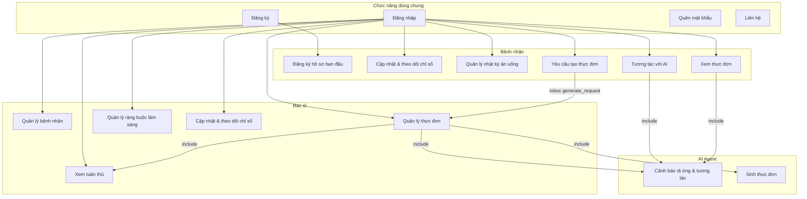

# Mô tả chức năng — VinNutri (P-014)

> Tài liệu **as-built** (cập nhật 2026-08-25): chuyển hoá sơ đồ Use Case + bảng tác nhân trong `UML_VinMec_10.docx` thành đặc tả chức năng khớp **code đang chạy**, không còn là brief triển khai cho các mục đã Done.
> Đối chiếu: `CLAUDE.md` (stack + MoSCoW), `specs/01-13` (Status từng spec), `contracts/api-v1.md` + `agent-io-schema.md`, backlog còn lại tại `tasks/roadmap-mvp.md`.
> Quy ước Status mỗi use case: **Done** (BE + FE chính đã nối API) · **Partial** (BE Done, FE còn gap / mock) · **Planned** (chưa có trong code) · **Ngoài MVP** (Could/Won't Have — giữ trên UML, không làm bản demo này).

---

## 0. Tác nhân hệ thống

| Tác nhân | Vai trò |
|---|---|
| **Bác sĩ / Chuyên gia dinh dưỡng** (`role=doctor`) | Quản lý bệnh nhân, sinh & duyệt thực đơn AI, áp dụng vào tuần, theo dõi tuân thủ, quản lý ràng buộc lâm sàng |
| **Bệnh nhân** (`role=patient`) | Khai báo hồ sơ, chat với AI, xem thực đơn, ghi nhật ký ăn uống, ghi nhận chỉ số, nhận nhắc tuân thủ |
| **AI** (tác nhân hệ thống, không phải actor login) | LangGraph Agent: RAG Q&A, đọc thực đơn, kiểm tra tương tác thuốc–thực phẩm, tóm tắt food log / tuân thủ / ghi chú bác sĩ, guardrails HITL. **Sinh thực đơn 7 ngày** chạy qua `meal_planner_agent` trên HTTP generate, không persist qua chat |
| **Chức năng dùng chung** | Đăng ký, Đăng nhập, Quên/đặt lại mật khẩu, Liên hệ (landing tĩnh) |

**Nguyên tắc HITL bắt buộc (khớp `CLAUDE.md` §7):** AI không tự chẩn đoán bệnh, không khuyến nghị đổi thuốc/liều lượng. Mọi kế hoạch dinh dưỡng phải qua bác sĩ duyệt **rồi áp dụng** (`approve` → `apply`) trước khi materialize nhắc nhở. Mọi số liệu AI trả về phải grounded + có citation từ RAG, không hallucinate.

---

## 0.1 Bản đồ màn hình as-built

### Bệnh nhân — chat-home (không còn sidebar nhiều trang)

Shell: `PatientChatShell` tại `/patient`. Thực đơn, nhật ký ăn, thông báo, chỉ số mở bằng **dock panel** bên phải, không phải route riêng.

| Route / surface | Việc |
|---|---|
| `/patient` | Chat-home: `POST /chat/stream` (SSE), session sidebar (`/chat/sessions`), card generative (thực đơn ngày/tuần, tuân thủ, ghi chú bác sĩ) |
| Dock **Thực đơn & Nhật ký** (`MealLogPanel`) | Xem plan đang áp dụng + ghi food log 3-slot (`POST/GET /food-log`) |
| Dock **Thông báo** (`NotificationsPanel`) | `GET /notifications` + read/dismiss/done |
| Dock **Chỉ số sức khỏe** (`HealthMetricsPanel`) | `GET /metrics/history`, `GET /compliance/me`, form `POST /metrics` |
| `/patient/onboarding` | Form nhiều bước → `POST /profile` → redirect `/patient` |
| `/patient/profile` | Sửa hồ sơ, avatar (`POST /auth/me/avatar`), chỉ số snapshot |

Route cũ `/patient/meals`, `/patient/history`, `/patient/notifications`, `/patient/assistant`, `/patient/home` **đã gỡ** — `nav-config.ts` còn href cũ nhưng shell bệnh nhân không dùng sidebar đó.

### Bác sĩ — roster + chart + inbox

Nav chính: Dashboard · Bệnh nhân · Hàng việc.

| Route | Việc |
|---|---|
| `/doctor` | Dashboard (danh sách BN + compliance — pha trộn API thật và fallback mock khi thiếu dữ liệu) |
| `/doctor/patients` | Danh sách BN, thêm BN (`POST /auth/register` + `PUT .../profile`) |
| `/doctor/inbox` | Hàng việc: chờ duyệt · ràng buộc pending · yêu cầu tạo TD · plan hết hạn |
| `/doctor/patients/{id}` | Hồ sơ (overview) |
| `/doctor/patients/{id}/meals` | Danh sách thực đơn của BN |
| `/doctor/patients/{id}/constraints` | Calo / muối / đường + nút xác nhận HITL |
| `/doctor/patients/{id}/compliance` | Biểu đồ tuân thủ + gửi nhắc |
| `/doctor/patients/{id}/history` | Lịch tuần 7 ngày (ADR-012) + apply/replace slot |
| `/doctor/patients/{id}/generate` | Sinh thực đơn AI (hàng đợi `QueueDrawer`) |
| `/doctor/patients/{id}/meals/{planId}` | Duyệt (approve/edit/reject) rồi **áp dụng** (`POST .../apply`) |

Redirect (IA cũ → mới): `/doctor/reviews` → inbox `plan_review`; `/doctor/reviews/{patientId}/{planId}` → `/doctor/patients/{id}/meals/{planId}`; `/doctor/patients/constraints` → inbox `constraints`; `/doctor/patients/compliance` → `/doctor`; `/doctor/history` → danh sách BN; `/doctor/messages` → `/doctor` (không có backend messaging).

---

## 1. Sơ đồ luồng use case tổng quan

North Star as-built: hồ sơ → (BN yêu cầu **hoặc** BS generate) → plan `pending_review` → BS duyệt → **apply** tuần → BN xem/ghi nhật ký/nhận nhắc → BS xem tuân thủ.

---

## 2. Nhóm chức năng: Bác sĩ / Chuyên gia dinh dưỡng

### 2.1 Quản lý bệnh nhân
**Status:** Done → `specs/02-patient-profile-onboarding.md` + `specs/03-doctor-patient-management.md`.

| Use case | Mô tả |
|---|---|
| Thêm bệnh nhân | Bác sĩ tạo tài khoản + hồ sơ trên `/doctor/patients` |
| Cập nhật thông tin bệnh nhân | Sửa trên chart `/doctor/patients/{id}` |
| Điều chỉnh mục tiêu dinh dưỡng | `target_kcal` / muối / đường qua tab Ràng buộc (`specs/04`), **không** qua `PUT .../profile` |
| Xóa bệnh nhân | `DELETE /doctor/patients/{id}` — xóa cascade dữ liệu liên quan |

**Luồng chính — Thêm bệnh nhân:**
1. Bác sĩ vào `/doctor/patients` → "Thêm bệnh nhân".
2. FE gọi `POST /api/v1/auth/register` với `role=patient`, sau đó `PUT /doctor/patients/{id}/profile` để bổ sung chi tiết. **Không** có endpoint `POST /api/v1/doctor/patients` (`specs/03` rule 2).
3. Hồ sơ map schema Profile: `disease`, `medications`, `allergies`, `bmi`/`weight`/`height`, `preferences`, `treatment_goals`. `target_kcal`/`restrictions` chỉ sửa qua endpoint constraints.
4. Lưu → BN xuất hiện trong `GET /api/v1/doctor/patients` (filter `q`, `status`, `plan_usage`, `meal_plan_request`).

**Edge case:**
- Trùng email → `409 EMAIL_EXISTS`.
- Thiếu disease/medications → cho lưu hồ sơ; generate plan vẫn chạy nhưng kém an toàn lâm sàng (cảnh báo ở bước generate, không chặn tạo hồ sơ).
- `PUT .../metrics` bắt buộc đủ cặp `weight` + `height` → `400 METRICS_INCOMPLETE`.

### 2.2 Quản lý thực đơn
**Status:** Done → `specs/05-meal-plan-generation.md` + `specs/06-meal-plan-review.md` + ADR-011/012. FE gap: nút "Yêu cầu điều chỉnh" phía bệnh nhân chưa gắn `POST /meal-plans/{id}/request-adjustment` (BE đã Done).

| Use case | Include | Mô tả |
|---|---|---|
| Tạo thực đơn bằng AI | `<<include>> A2` | BS generate hộ BN tại `/doctor/patients/{id}/generate` |
| Tiếp nhận yêu cầu tạo TD | | BN gọi `POST /meal-plans/request` → job inbox `generate_request` |
| Cập nhật thực đơn | | `action=edit` + `edited_plan` full-replace khi duyệt; tra cứu món `GET /doctor/foods` |
| Tạo lại thực đơn | | Generate lại sau reject / hết hạn slot |
| Duyệt / Từ chối / Áp dụng | | `approve` / `reject` / `edit` rồi `POST .../apply` gán tuần |
| Cảnh báo dị ứng và tương tác | `<<include>> A1` | Agent swap món "Nguy hiểm", gắn cảnh báo "Cần chú ý" |
| Phản hồi và điều chỉnh | Partial | BE `request-adjustment` Done; FE bệnh nhân chưa có nút. Adaptive feedback Should Have — chưa pipeline tinh chỉnh generate |

**Luồng chính — Tạo, duyệt, áp dụng (North Star):**
1. Nguồn việc: inbox "Yêu cầu tạo TD", hoặc BS mở `/doctor/patients/{id}/generate`.
2. FE gọi `POST /api/v1/doctor/patients/{id}/meal-plans/generate` (hàng đợi `QueueDrawer`). Generate **không** nhận ngày áp dụng.
3. BE load Profile → `meal_planner_agent` (luôn chạy, không nhánh `DEMO_MOCK`) → 7 ngày, mỗi món có citation.
4. Agent chạy `interaction_checker_agent` trên món trong plan (KB `drug_food_interactions.json`, ~28 cặp): "Nguy hiểm" → swap + `swaps[]`; "Cần chú ý" → cảnh báo, không swap. Cặp không có trong KB → `unmatched_pairs[]`.
5. Plan persist `status=pending_review`. Cờ `meal_plan_request_status` của BN reset về `"none"`.
6. Inbox `plan_review` / `GET /doctor/meal-plans?status=pending_review` → mở `/doctor/patients/{id}/meals/{planId}`.
7. Bác sĩ chọn:
   - **Duyệt** → `POST /doctor/meal-plans/{id}/review` `{action: approve}` → `approved` + `Notification(type=plan_approved)`. **Chưa** tạo `meal_reminder` / `adherence_checkin`.
   - **Từ chối** → `{action: reject, notes}` → `rejected`; hủy notification `pending` gắn plan.
   - **Sửa tay** → `{action: edit, edited_plan}` full-replace → `edited`. **Không** có PUT cấp món riêng (`specs/06` §6).
   - Review lần 2 khi không còn `pending_review` → `409 PLAN_ALREADY_REVIEWED`.
8. **Áp dụng** → `POST /doctor/meal-plans/{id}/apply` `{start_date, replace_active, slot_key}` (tab Lịch sử hoặc ngay sau duyệt). Side-effect: stamp `starts_on`/`ends_on`, materialize `meal_reminder`/`adherence_checkin` (bỏ slot đã qua). `replace_active: true` cắt `ends_on` plan cũ = `start_date - 1`.

### 2.3 Xem tuân thủ
**Status:** Done (core) → `specs/10-doctor-compliance-view.md` + `specs/11-compliance-notification-delivery.md`.

| Use case | Mô tả |
|---|---|
| Xem biểu đồ tuân thủ | Tab `/doctor/patients/{id}/compliance` — `GET /doctor/patients/{id}/compliance?days=14` |
| Cảnh báo tuân thủ | Badge khi `overall_adherence_pct` < `COMPLIANCE_LOW_THRESHOLD_PCT` (default **50**, không phải 60) |
| Nhắc nhở bệnh nhân | `POST /doctor/patients/{id}/compliance/remind` → `Notification(type=manual_reminder)` |
| Xem nhật ký ăn uống | BS không có trang food-log chi tiết; tuân thủ suy từ check-in + food log (ngày lịch Asia/Ho_Chi_Minh) |

**Luồng chính:**
1. Mở tab Tuân thủ trên chart BN (danh sách cũ `/doctor/patients/compliance` redirect dashboard).
2. FE gọi compliance API — aggregation on-the-fly từ `adherence_checkin` done + Alert mức Nguy hiểm/Cần chú ý (ADR-008). **Không** có bảng summary riêng.
3. Vẽ `daily_series` + `overall_adherence_pct`. Ngày không có check-in done → `adherence_pct: null`.
4. Tuân thủ thấp → gửi nhắc thủ công.

### 2.4 Quản lý ràng buộc lâm sàng
**Status:** Done → `specs/04-clinical-constraints.md`. UI tab `/doctor/patients/{id}/constraints`. Ghi chú lâm sàng trên UI (nếu còn) là local state — **không** có endpoint persist.

| Use case | Mô tả |
|---|---|
| Xem ràng buộc | `target_kcal`, `salt_daily_g`, `sugar_daily_g` (schema `Restrictions` còn song song `carb_per_meal`/`sodium_daily` phía patient) |
| Cập nhật ràng buộc | `PUT /doctor/patients/{id}/constraints` — partial, áp dụng ngay lần generate sau. Meal planner: `effective_sodium_mg = min(sodium_daily, salt_daily_g * 400)` khi cả hai có giá trị |
| Xác nhận thay đổi BN tự sửa | HITL: patient `POST /profile` đổi kcal/restrictions → lưu `proposed_*`, `constraints_status=pending_doctor_review` (cột hiệu lực **không** đổi; generate vẫn dùng giá trị bác sĩ). Doctor `POST .../constraints/approve` chép proposed → hiệu lực. `400 NOTHING_TO_APPROVE` nếu đã confirmed |

**Luồng chính:**
1. Inbox filter `constraints` hoặc tab Ràng buộc trên chart.
2. Sửa Calo · Muối · Đường → PUT constraints (doctor tự sửa cũng reset status về `confirmed`).
3. Badge "Chờ bác sĩ xác nhận" + nút Xác nhận khi `pending_doctor_review`.
4. `protein_daily_g` **Won't Have** — không nằm trong form bác sĩ.

### 2.5 Cập nhật và theo dõi chỉ số (góc nhìn bác sĩ)
**Status:** Done (core) → `specs/12-patient-metrics-tracking.md` (ADR-013). Phân tích xu hướng / intent `metric_feedback` — **Planned**.

| Use case | Mô tả |
|---|---|
| Theo dõi chỉ số | Chart overview + `PUT /doctor/patients/{id}/metrics` — snapshot `profiles` + append `body_metrics_history` |
| Phân tích xu hướng | Planned — chưa có so sánh tuần/tháng hay advice AI khi chỉ số đổi |

**Luồng chính:**
1. BS cập nhật cân/cao trên hồ sơ BN; BMI tính server-side (ngưỡng châu Á).
2. BN tự xem/ghi trên dock Chỉ số (`GET /metrics/history`, `POST /metrics` upsert 1 bản ghi/ngày VN).
3. Lời khuyên khi delta vượt ngưỡng — **chưa có** node/intent.

---

## 3. Nhóm chức năng: Bệnh nhân

### 3.1 Đăng ký hồ sơ ban đầu (Onboarding)
**Status:** Done → `specs/02-patient-profile-onboarding.md` + `specs/01-account-auth.md`.

| Use case | Mô tả |
|---|---|
| Khai báo thông tin cơ bản | Họ tên (register), tuổi, giới tính, SĐT, địa chỉ |
| Khai báo hồ sơ bệnh lý | `disease[]`, `medications[]` |
| Khai báo dị ứng | `allergies[]` (hard filter khi generate) |
| Đặt mục tiêu | `target_kcal`, `treatment_goals`, `preferences` (5 pattern: bò/chay/hải sản/heo/gà) |

**Luồng chính:** `POST /auth/register` → login → `/patient/onboarding` (3 bước) → `POST /api/v1/profile` (upsert) → `/patient`. Nếu BN gửi kcal/restrictions khác giá trị đã duyệt → `proposed_*` + `constraints_status=pending_doctor_review` (phác đồ vẫn dùng giá trị bác sĩ).

### 3.2 Cập nhật và theo dõi chỉ số
**Status:** Done (ghi nhận + lịch sử + overlay đa chỉ số + `metrics_delta_advice`).

| Use case | Mô tả |
|---|---|
| Ghi nhận chỉ số mới | Dock Chỉ số → `POST /metrics` (cân, HA tâm thu/trương, đường lúc đói/sau ăn, vòng eo, HbA1c); upsert theo ngày Asia/Ho_Chi_Minh |
| Theo dõi chỉ số | `GET /metrics/history?days=90` — overlay nhiều đường + forecast nét đứt; vòng tuân thủ `GET /compliance/me` |
| Xóa bản ghi | `DELETE /metrics/{id}` |
| Lời khuyên theo thay đổi | Intent `metrics_delta_advice` + `delta_advice` trên `POST /metrics` khi vượt ngưỡng |

### 3.3 Quản lý nhật ký ăn uống (Food Log)
**Status:** Done (core) — `specs/09-food-log-adherence.md`, ADR-009. Structured 3-slot `morning\|noon\|evening`, `as_planned\|custom`. Không NLP, không ảnh.

| Use case | Mô tả |
|---|---|
| Ghi nhận tuân thủ bữa | Dock Thực đơn (`MealLogPanel`) — không còn modal trên `/patient/meals` |
| Xem tóm tắt đã ăn | Cùng panel + chart adherence tuần; chat intent `food_log` chỉ **đọc** 3 log gần nhất |
| Cảnh báo khi log custom | BE tạo `Alert` + `alert_ids[]` nếu ghi chú khớp cặp thuốc–thực phẩm nguy hiểm |

Một user / một ngày VN / một slot = một log (upsert). `logged_at` timezone-aware.

### 3.4 Xem thực đơn
**Status:** Done (Must/Should) → `specs/07-patient-meal-plan-view.md`. Đi chợ / gợi ý khu vực — Ngoài MVP.

| Use case | Include | Mô tả |
|---|---|---|
| Xem chi tiết thực đơn | | Chat card + dock menu: plan đang apply (`GET /meal-plans/me`, schedule `GET /meal-plans/schedule`) |
| Xem món thay thế | `<<include>> A1` | `swaps[]` / `alternatives[]` trên món bị đổi |
| Yêu cầu tạo thực đơn | | Khi chưa có plan apply / plan hết hạn: `POST /meal-plans/request` (không tự gọi AI generate trên UI) |
| Tạo danh sách đi chợ | | **Ngoài MVP** — không có `GET .../shopping-list` |
| Phản hồi và điều chỉnh | Partial | BE `request-adjustment` Done; FE chưa có nút. Chat `meal_plan` **read-only**, không persist plan mới |
| Gợi ý khu vực bán | | **Ngoài MVP** |

**Luồng xem swap:**
1. BN mở card/dock → badge món đã thay thế.
2. Hiện món gốc, `mechanism` + `severity`, món thay, citation — dữ liệu `swaps[]` từ bước generate.

**Lazy notification hết hạn:** `GET /meal-plans/me` materialize một lần `plan_expiring` / `plan_expired` khi bucket ADR-011 tương ứng.

### 3.5 Tương tác với AI
**Status:** Done (core) → `specs/13-ai-chat-assistant.md`. Planned: hybrid RAG, dual-provider LLM.

| Use case | Mô tả |
|---|---|
| Xem / hỏi thực đơn | Intent `meal_plan` — đọc plan DB, card `MealSuggestionCard` / `WeeklyMealPlanCard` |
| Hỏi tương tác thuốc–thực phẩm | Intent `interaction_check` — `interaction_checker_agent` + KB đầy đủ |
| Tra cứu thực phẩm / guideline | Intent `rag_qa` — dense retrieval (chưa `retrieve_hybrid`) + citation |
| Tóm tắt nhật ký ăn | Intent `food_log` — đọc DB, không tạo log |
| Tuân thủ tuần | Intent `weekly_compliance` — cùng `ComplianceService` với `GET /compliance/me` |
| Ghi chú bác sĩ | Intent `doctor_note` — list `manual_reminder` (tên/ảnh bác sĩ được gán, không hallucinate) |
| Từ chối phạm vi y khoa | Intent `refuse` — `get_refuse_message()` |
| Greeting / unknown | Intent `greeting` / `unknown` |
| Đi chợ / map bán | Ngoài MVP |

**Luồng chính (`/patient`):**
1. BN gõ câu hoặc bấm chip; session lưu qua `/chat/sessions` (transcript UI, **không** đưa vào `run_agent` — mỗi lượt stateless).
2. `POST /api/v1/chat/stream` (ưu tiên) hoặc `POST /chat`: `profile_loader` (DB) → `intent_classifier` → node tương ứng → `apply_guardrails`.
3. Intent: `greeting` \| `meal_plan` \| `interaction_check` \| `food_log` \| `rag_qa` \| `refuse` \| `unknown` \| `weekly_compliance` \| `doctor_note`. Câu ghép → `secondary_intents[]` (gợi ý hỏi lại, không chạy song song).
4. Guardrails: `enforce_citation_guardrail` (RAG thiếu citation → redact) + `enforce_interaction_recommendations` (sanitize từng `recommendation`) + `enforce_output_safety` (chặn đổi thuốc). SSE có thể emit `correction`.
5. FE render text + citations + card (`meal_preview`, `weekly_compliance`, `doctor_note`, `meal_plan_week`).

---

## 4. Nhóm chức năng: Chức năng dùng chung

| Use case | Status | API / surface |
|---|---|---|
| Đăng ký | Done | `POST /api/v1/auth/register` — `role` ∈ `{patient, doctor}` |
| Đăng nhập | Done | `POST /api/v1/auth/login` — JWT; rate-limit 5 lần sai / 15 phút → `429 TOO_MANY_ATTEMPTS` |
| Quên mật khẩu | Done | FE `/forgot-password` → `POST /auth/forgot-password` (SMTP mật khẩu mới, luôn 200); `/reset-password` nếu dùng token |
| Ảnh đại diện | Done | `POST /auth/me/avatar` (BN); `POST /doctor/patients/{id}/avatar` (BS hộ) |
| Liên hệ | Ngoài MVP API | Landing `/` mục `#lien-he` — form tĩnh, không endpoint |

---

## 5. Đối chiếu codebase (cho agent trước khi code)

### 5.1 Đã Done — không làm lại

Auth (kể cả quên MK + rate-limit), profile onboarding, doctor roster/chart, generate meal plan, review + optimistic lock, **apply tuần** (ADR-011/012), interaction HTTP + chat (1 KB), Food Log, metrics time-series, notifications event-driven + `demo/simulate` idempotent, Doctor Compliance + `GET /compliance/me`, HITL constraints approve, chat SSE + sessions + `secondary_intents`, `unmatched_pairs[]`, `PUT .../constraints`, Gemini embedding + Qdrant, Postgres only.

### 5.2 Gap thật còn lại (khớp `tasks/roadmap-mvp.md`)

Không còn P0 interaction-501, HITL constraints, hay optimistic lock — các mục đó đã as-built.

| Ưu tiên | Việc | Ghi chú |
|---|---|---|
| Should / P1 | `rag_qa_node` dùng `retrieve_hybrid()` | BM25+dense đã có trong `retriever.py`, chat vẫn dense-only |
| Should | Corpus guideline RAG (`data/guidelines/*.md` trừ `patient_faq.md`) | Nhiều file còn placeholder |
| Should | Intent lời khuyên khi chỉ số đổi | `specs/12` §6 |
| Should | Dual-provider LLM OpenAI↔DeepSeek | ADR-004 Planned; as-built `LLM_PROVIDER` single |
| Partial FE | Nút `request-adjustment` trên UI BN | BE Done, `api.requestMealPlanAdjustment` chưa gắn màn |
| Could | Dashboard `/doctor` dọn mock còn lại | `THIS_WEEK_DATA` fallback |
| Could | Đi chợ / PDF / messaging | Chưa có backend; `/doctor/messages` redirect |
| Could | Persist ghi chú lâm sàng | Local state, chưa có API |
| Could | Alembic thay `_migrate_add_*` | Không gấp cho demo |

**Đã chốt không làm:** `POST /doctor/patients`; PUT cấp món; persist meal plan qua `/chat` (read-only by design); NLP/ảnh food log; `protein_daily_g` ràng buộc doctor.

### 5.3 Lệch pha UML / đề bài vs as-built

| Tính năng UML/đề bài | Trạng thái repo |
|---|---|
| Food Log structured | **Done** (ADR-009) |
| Metrics time-series | **Done** (ADR-013) |
| BN tự generate thực đơn trên UI | API `POST /meal-plans/generate` còn; **UI chính** là yêu cầu bác sĩ tạo |
| Chat-home thay dashboard BN | **Done** — `/patient` là assistant + dock |
| Danh sách đi chợ / map bán | **Could Have** — chưa có |
| NLP / ảnh món ăn | **Won't Have** |
| Patient/doctor messaging | UI cũ redirect; **chưa có spec/API** |
| Duyệt 1 bước = có nhắc nhở | **Không** — phải `apply` mới materialize reminder |

Khi nộp UML: giữ use case trên diagram, ghi chú cắt scope có chủ đích cho prototype.

### 5.4 Use case A1 — include dùng chung

Mọi luồng sinh plan, xem plan, food log custom, chat tương tác **tái dùng** `interaction_checker_agent` + KB `data/drug_food_interactions.json` (Postgres `drug_products`/`drug_rules` hoặc fallback JSON). Không viết logic tương tác thuốc–thực phẩm rời.

---

## 6. Thứ tự việc còn lại

SSOT ưu tiên: **[`tasks/roadmap-mvp.md`](../tasks/roadmap-mvp.md)**.

1. Guardrails runtime bổ sung (B1) và hybrid RAG chat (B2).
2. Chất lượng corpus guideline (B5) — ảnh hưởng demo RAG Q&A.
3. FE: `request-adjustment`, dọn mock dashboard bác sĩ (B6).
4. Dual-provider LLM (B3) — không chặn North Star.
5. Could Have: metric_feedback, đi chợ/PDF, Alembic, messaging, lint debt FE.

**Không còn trên backlog triển khai:** `DEMO_MOCK` interaction 501, HITL constraints, optimistic lock review, persist plan qua chat, Food Log, metrics history, compliance view, `profile_loader` DB, citation+safety guardrails, Gemini embedding.
