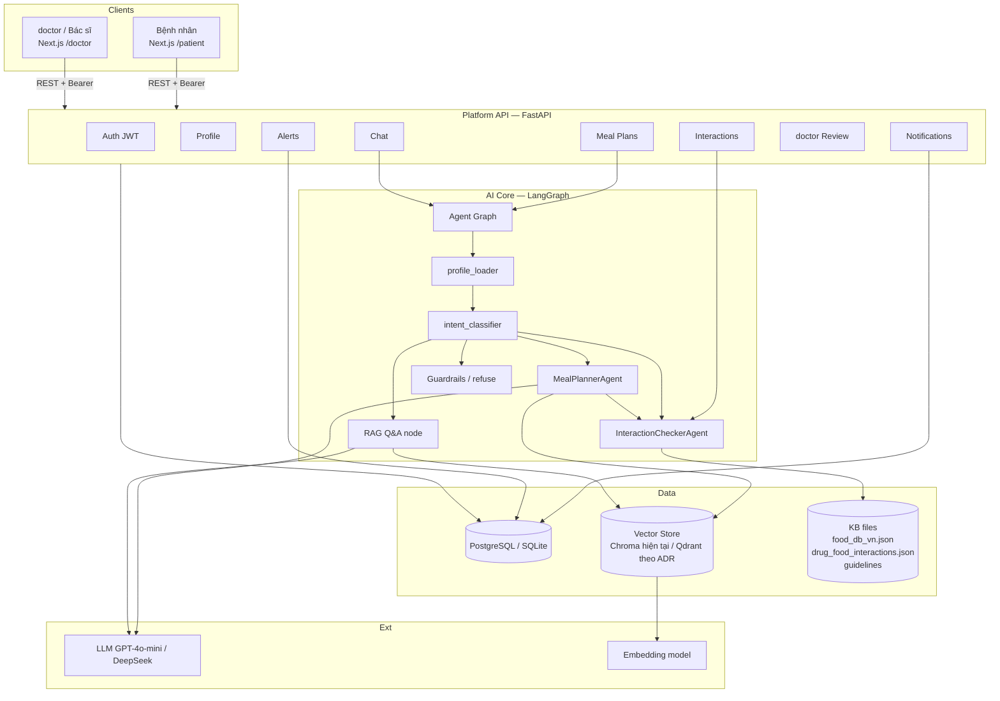
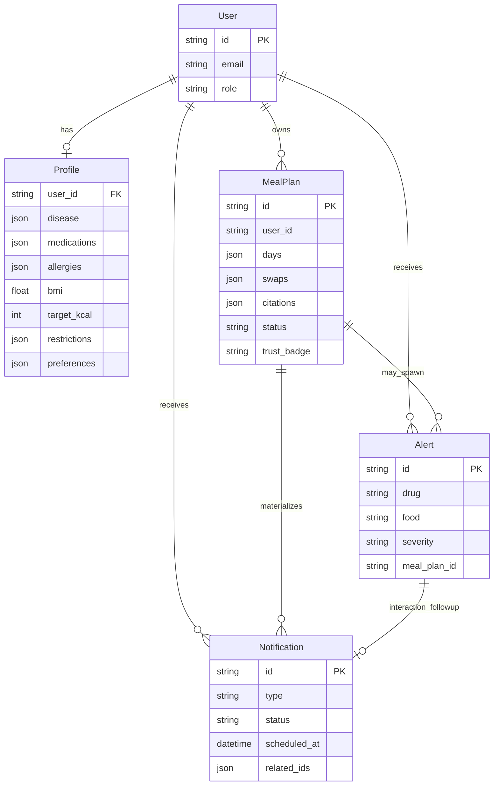
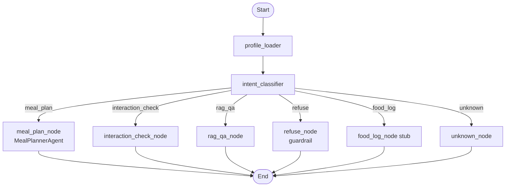
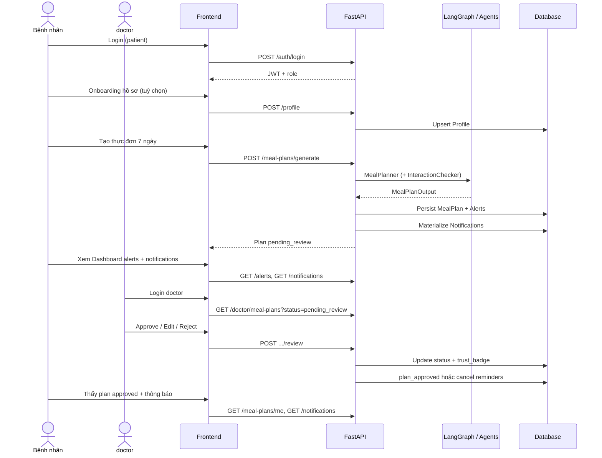

# Mô tả hệ thống — AI Trợ lý Dinh dưỡng & Lối sống theo bệnh lý (P-014)

> Tài liệu kỹ thuật hệ thống: chức năng hiện có, kiến trúc as-built, và luồng hoạt động khi phát triển hoàn chỉnh (to-be / North Star demo).  
> Ngày tổng hợp: **2026-08-12** · Nguồn: codebase `backend/`, `frontend/`, `CLAUDE.md`, contract Agent/API.

---

## 1. Tổng quan sản phẩm

**P-014** là prototype AI Agent hỗ trợ bệnh nhân mắc bệnh mạn tính (tiểu đường type 2, tăng huyết áp, gout, tim mạch…) nhận:

1. **Hồ sơ sức khỏe / dinh dưỡng** cá nhân hoá  
2. **Thực đơn 7 ngày** theo bệnh lý, thuốc, dị ứng và mục tiêu kcal  
3. **Cảnh báo tương tác thuốc–thực phẩm**  
4. **Nhắc tuân thủ (Compliance Notification)** in-app  
5. **Duyệt thực đơn bởi chuyên gia dinh dưỡng / bác sĩ** (approve / edit / reject)

**North Star (demo end-to-end):**  
Bệnh nhân đăng nhập → (tuỳ chọn) onboarding hồ sơ → tạo thực đơn 7 ngày → nhận alerts + notifications → doctor duyệt → bệnh nhân thấy trạng thái đã duyệt / `plan_approved`.

**Nguyên tắc thiết kế:** ưu tiên **một demo flow mượt** hơn việc thêm nhiều tính năng nửa vời.

| Vai trò API | Vai trò UI Frontend | Mô tả |
|---|---|---|
| `patient` | Bệnh nhân (`/patient/*`) | Nhập hồ sơ, xem thực đơn, alerts, thông báo, chat trợ lý |
| `doctor` | Bác sĩ / chuyên gia (`/doctor/*`) | Danh sách bệnh nhân, duyệt kế hoạch, theo dõi tuân thủ |

---

## 2. Phạm vi chức năng (MoSCoW)

### 2.1 Must Have (MVP / demo)

| Chức năng | Mô tả ngắn |
|---|---|
| Hồ sơ bệnh nhân | Disease, medications, allergies, BMI, target_kcal, restrictions, preferences |
| Meal plan 7 ngày (RAG) | Sinh thực đơn cá nhân hoá + citations |
| Drug–food interaction + Alert | Kiểm tra KB tương tác, tạo alert, swap món nguy hiểm |
| Compliance Notification (in-app) | Nhắc bữa, follow-up tương tác, plan approved, check-in tuân thủ |
| Nutrition calculator | Tổng kcal/macro theo ngày, so với target & restrictions |
| Guardrails + nguồn trích dẫn | Không kê/đổi thuốc; số liệu dinh dưỡng phải có citation |
| doctor review UI | Approve / edit / reject + trust badge |

### 2.2 Should / Could (sau demo hoặc nâng cao)

Adaptive feedback, memory preferences, chat Q&A sâu hơn, cảnh báo ngưỡng dinh dưỡng, food recognition ảnh, danh sách đi chợ, export PDF, push FCM/APNs, wearable sync.

### 2.3 Won't Have (MVP này)

**Food Log** (text/search/NLP) — stub/route có thể còn trong repo nhưng **đã ẩn khỏi nav demo**. Billing, multi-language, social.

---

## 3. Trạng thái hiện tại (As-built)

### 3.1 Backend — đã có khung chạy được

| Thành phần | Trạng thái | Ghi chú |
|---|---|---|
| FastAPI entry (`app/main.py`) | ✅ | CORS, health, mount `/api/v1/*` |
| Auth JWT (register/login) | ✅ | Role `patient` / `doctor`, seed demo accounts |
| Profile upsert/get | ✅ | `POST/GET /api/v1/profile` |
| Meal plan generate/get | ✅ | `DEMO_MOCK=true` (mặc định) trả mock ổn định; `false` gọi LangGraph |
| Interaction check API | ✅ | `POST /api/v1/interactions/check` |
| Alerts list | ✅ | Persist khi generate plan |
| Notifications CRUD-lite | ✅ | Materialize event-driven; demo simulate |
| doctor review | ✅ | approve / reject / edit |
| Chat → `run_agent` | ✅ | Thin wrapper LangGraph |
| LangGraph graph | ✅ | profile → intent → route (meal/interaction/RAG/refuse…) |
| MealPlannerAgent | ✅ (code) | RAG foods/guidelines + NutritionCalculator + swap |
| InteractionCheckerAgent | ✅ | KB `drug_food_interactions.json` |
| RAG (ChromaDB) | ✅ (code) | Dense retrieval; hybrid BM25 trong retriever |
| Guardrails `rules.py` | ⚠️ | Hiện còn placeholder; logic refuse nằm trong graph node |
| Food Log routes/agent | 🚫 / stub | Ngoài MVP; node stub trong graph |
| PostgreSQL prod | ⚠️ | Dev mặc định **SQLite** (`app.db`) |
| Vector DB theo ADR (Qdrant) | ⚠️ | Code hiện dùng **ChromaDB**; ADR chọn Qdrant (target) |

### 3.2 Frontend — UI shell theo 2 role, phần lớn mock

| Khu vực | Route chính | Trạng thái |
|---|---|---|
| Auth | `/login`, `/register` | UI có; demo buttons map tài khoản seed |
| Patient home | `/patient` | Dashboard mock (kế hoạch hôm nay, alerts…) |
| Onboarding | `/patient/onboarding` | Form hồ sơ |
| Meals | `/patient/meals` | Xem / tạo thực đơn (UI) |
| Food log UI | `/patient/meals/log` | Có route nhưng **ẩn khỏi MVP** |
| Notifications | `/patient/notifications` | Trung tâm thông báo |
| Assistant | `/patient/assistant` | Chat trợ lý |
| Messages | `/patient/messages` | **Mock local** |
| Doctor dashboard | `/doctor` | Tổng quan |
| Patients / queue | `/doctor/patients/*` | Danh sách, generate plan, constraints, compliance |
| Reviews | `/doctor/reviews/...` | Duyệt kế hoạch |
| History / messages | `/doctor/history`, `/doctor/messages` | UI + mock |

**Lưu ý kỹ thuật FE hiện tại:** chưa thấy lớp `fetch`/`api.ts` gắn chặt REST backend trong `frontend/lib`; state dùng Zustand store cục bộ / mock-data. Hướng đích khi hoàn thiện: FE chỉ phụ thuộc OpenAPI/schemas ổn định.

### 3.3 Infra hiện tại

```
docker-compose: backend (8000) + frontend (3000)
DB: SQLite volume/file
Vector: Chroma persist dir (chroma_db)
DEMO_MOCK=true → meal plan mock cho pitch ổn định
```

---

## 4. Kiến trúc hệ thống

### 4.1 Sơ đồ tổng thể (target / khi hoàn chỉnh)



### 4.2 Phân tầng & ownership

| Tầng | Công nghệ | Owner | Trách nhiệm |
|---|---|---|---|
| Presentation | Next.js 14 App Router, Tailwind, Zustand | FE | 2 shell role, UX 4+ màn North Star |
| Application / API | FastAPI, Pydantic, JWT | BE2 | Routes, persist, notification service, doctor |
| AI / Domain agents | LangGraph, LangChain-style RAG | BE1 | Graph, agents, indexer/retriever, nutrition calc |
| Data | SQLAlchemy models; vector store; JSON KB | BE2 (RDB) · BE1 (KB/vector) | Users, profiles, plans, alerts, notifications |

**Handoff rule:** đổi schema Agent/API → cập nhật contract trước, rồi mới code.

### 4.3 Tech stack chi tiết

| Layer | Lựa chọn thực tế trong repo | Ghi chú ADR / CLAUDE |
|---|---|---|
| Frontend | Next.js 14, Tailwind, Zustand | Deploy Vercel |
| Backend | FastAPI + Uvicorn | Deploy Railway |
| Auth | JWT (`python-jose` / bcrypt hash) | 2 role |
| ORM / DB | SQLAlchemy; SQLite default | Prod: PostgreSQL |
| Agent | LangGraph StateGraph | Intent routing |
| LLM | `LLM_MODEL` (mặc định gpt-4o-mini) | Có thể DeepSeek qua env |
| Embedding | `paraphrase-multilingual-MiniLM-L12-v2` | CLAUDE đề cập Gemini Embedding 2 |
| Vector DB | **ChromaDB** persist | ADR 001: **Qdrant** (target) |
| RAG | Dense retrieve (+ BM25 hybrid trong module) | Citations bắt buộc |
| Orchestration demo | `DEMO_MOCK` flag | Tắt để chạy agent thật |

### 4.4 Cấu trúc thư mục lõi

```
P-014/
├── backend/app/
│   ├── main.py                 # FastAPI app
│   ├── api/v1/                 # auth, profile, meal_plan, chat,
│   │                           # interactions, alerts, notifications, doctor
│   ├── agents/                 # LangGraph graph + nodes + agents
│   ├── rag/                    # indexer, retriever, embeddings
│   ├── guardrails/             # rules, source_check
│   ├── models/                 # User, Profile, MealPlan, Alert, Notification
│   ├── schemas/                # Pydantic contract mirror
│   ├── services/               # meal_plan_service, notification, nutrition_calculator
│   └── db/                     # session, init_db + seed demo
├── backend/data/               # food_db_vn.json, drug_food_interactions.json, guidelines/
├── frontend/app/
│   ├── (auth)/                 # login, register
│   ├── patient/                # dashboard, meals, notifications, assistant...
│   └── doctor/                 # patients, reviews, compliance, messages...
├── frontend/components/        # shared shell, doctor widgets
├── frontend/lib/               # nav-config, stores, mock-data
├── contracts/                  # agent-io-schema (boundary FE↔BE↔Agent)
├── specs/ · adrs/ · tasks/     # đặc tả, quyết định kiến trúc, roadmap
└── docker-compose.yml
```

### 4.5 Mô hình dữ liệu chính



**Status meal plan:** `pending_review` → `approved` | `rejected` | `edited`  
**Severity interaction:** `Nguy hiểm` | `Cần chú ý` | `An toàn`  
**Notification types:** `meal_reminder` | `interaction_followup` | `plan_approved` | `adherence_checkin`  
**Notification status:** `pending` | `sent` | `read` | `dismissed` | `done` | `cancelled`

### 4.6 API surface (v1)

| Method | Path | Role | Mục đích |
|---|---|---|---|
| POST | `/api/v1/auth/register` | public | Đăng ký |
| POST | `/api/v1/auth/login` | public | JWT |
| POST | `/api/v1/profile` | patient | Upsert hồ sơ |
| GET | `/api/v1/profile/me` | patient | Lấy hồ sơ |
| POST | `/api/v1/meal-plans/generate` | patient | Sinh + persist plan |
| GET | `/api/v1/meal-plans/me` | patient | Plan mới nhất |
| GET | `/api/v1/meal-plans/{id}` | auth | Chi tiết plan |
| POST | `/api/v1/interactions/check` | auth | Check thuốc–thực phẩm |
| GET | `/api/v1/alerts` | patient/doctor | Danh sách alert |
| GET | `/api/v1/notifications` | patient | Lọc theo status/type |
| POST | `/api/v1/notifications/{id}/read\|dismiss\|done` | patient | Cập nhật trạng thái |
| POST | `/api/v1/notifications/demo/simulate` | demo | Hiện noti ngay khi pitch |
| GET | `/api/v1/doctor/meal-plans` | doctor | Hàng đợi duyệt |
| POST | `/api/v1/doctor/meal-plans/{id}/review` | doctor | approve/reject/edit |
| POST | `/api/v1/chat` | patient | Chạy agent theo message |
| GET | `/health` | public | Healthcheck |

---

## 5. Kiến trúc AI Agent (LangGraph)

### 5.1 Luồng graph



**Facade:** `run_agent(AgentRunInput) → AgentRunOutput` — BE2 gọi từ chat / (khi `DEMO_MOCK=false`) từ generate meal plan.

### 5.2 MealPlannerAgent — pipeline nội bộ

```
PatientProfile
  → RAG retrieve guidelines + foods
  → Draft 7 ngày × slots (breakfast/lunch/dinner[/snack])
  → Hard filter allergies
  → Soft apply preferences + restrictions
  → NutritionCalculator (totals, ±10% target, warnings)
  → InteractionChecker (Nguy hiểm → swap + ghi swaps[])
  → Citations / source check
  → MealPlanOutput status=pending_review
```

### 5.3 InteractionCheckerAgent

- Input: `medications[]`, `foods[]`  
- KB: `backend/data/drug_food_interactions.json`  
- Match accent-insensitive + alias  
- Output: `interactions[]` → persist thành `Alert` khi gắn với meal plan

### 5.4 Guardrails (nguyên tắc cứng)

- Không khuyến nghị đổi thuốc / đổi liều / kê đơn / chẩn đoán → redirect bác sĩ  
- Mọi số liệu dinh dưỡng AI trả về **phải có citation** từ RAG/KB  
- Intent ngoài phạm vi → `refuse` / `unknown` với message hướng dẫn

---

## 6. Luồng hoạt động khi phát triển xong (To-be)

Các luồng dưới đây mô tả **hành vi hệ thống hoàn chỉnh theo North Star**, không chỉ phần UI mock hiện tại.

### 6.1 North Star end-to-end (5 scene demo)



### 6.2 Auth & phân quyền

1. User đăng ký với `role` ∈ {`patient`, `doctor`} hoặc dùng tài khoản seed.  
2. Login trả `access_token` (Bearer).  
3. Mọi API nghiệp vụ yêu cầu JWT; doctor routes dùng `require_roles("doctor")`.  
4. FE shell `/doctor/*` khớp role API `doctor`; `/patient/*` khớp `patient`.

**Tài khoản demo seed:**

| Email | Password | Role |
|---|---|---|
| `demo_patient_1@example.com` | `demo1234` | patient (T2DM + HTN, metformin + warfarin) |
| `demo_patient_2@example.com` | `demo1234` | patient |
| `demo_patient_3@example.com` | `demo1234` | patient (gout) |
| `demo_doctor@example.com` | `demo1234` | doctor |

### 6.3 Hồ sơ bệnh nhân (Onboarding)

**Actor:** Bệnh nhân  

**Luồng:**

1. Vào `/patient/onboarding`  
2. Nhập disease, medications, allergies, BMI, target_kcal, restrictions, preferences  
3. `POST /api/v1/profile` upsert  
4. Profile trở thành input chuẩn cho mọi Agent  

**Schema tham chiếu:**

```json
{
  "disease": ["diabetes_t2", "hypertension"],
  "medications": ["metformin", "amlodipine"],
  "allergies": ["hải sản"],
  "bmi": 26.5,
  "target_kcal": 1800,
  "restrictions": { "carb_per_meal": 45, "sodium_daily": 1500 },
  "preferences": ["thích ăn cơm", "không ăn thịt bò"]
}
```

### 6.4 Sinh thực đơn 7 ngày

**Actor:** Bệnh nhân (tự generate) hoặc doctor (generate hộ trên `/doctor/patients/{id}/generate`)

**Luồng hoàn chỉnh:**

1. Client gọi `POST /api/v1/meal-plans/generate`  
2. Platform load `PatientProfile` từ DB  
3. **Nhánh demo:** `DEMO_MOCK=true` → `build_mock_meal_plan` (ổn định cho pitch)  
4. **Nhánh production/agent:** `run_agent(force_intent=meal_plan)` → MealPlannerAgent + RAG  
5. Persist `MealPlan` (`status=pending_review`)  
6. Chạy InteractionChecker trên danh sách món → tạo `Alert`  
7. `NotificationService.materialize_from_meal_plan`:
   - `meal_reminder` theo từng slot/ngày (scheduled_at)  
   - `adherence_checkin` cuối ngày (~21:00)  
8. Với alert severity ∈ {Nguy hiểm, Cần chú ý} → thêm `interaction_followup`  
9. FE hiển thị thực đơn 7 ngày, citations, swaps, badge chờ duyệt  

**SLA mục tiêu:** generate < 15s (p95).

### 6.5 Kiểm tra tương tác thuốc–thực phẩm (độc lập + gắn plan)

**A. Gắn meal plan (tự động)** — như bước 6–8 ở §6.4.  

**B. Kiểm tra ad-hoc / chat:**

1. User hỏi “warfarin ăn rau muống được không?” hoặc gọi `POST /interactions/check`  
2. Intent → `interaction_check`  
3. Agent match KB → trả mechanism, severity, recommendation, sources  
4. FE Dashboard hiển thị Alert list  

### 6.6 Compliance Notification

**Chiến lược (ADR 004):** in-app only; **event-driven materialize-ahead** (không bắt buộc cron/FCM trong MVP).

| Sự kiện | Notification tạo ra |
|---|---|
| Meal plan generated | `meal_reminder` × slots × days (`pending`) + `adherence_checkin` × 7 |
| Plan approved | `plan_approved` (`sent`) |
| Plan rejected | Huỷ (`cancelled`) các reminder/checkin tương lai của plan đó |
| Alert Nguy hiểm / Cần chú ý | `interaction_followup` (`sent`) |

**Hành vi user trên FE:**

1. Mở `/patient/notifications` (poll / fetch on focus)  
2. Đọc → `POST .../read`  
3. Bỏ qua → `dismiss`  
4. Check-in tuân thủ → `done` kèm `adherence: yes|partial|no`  
5. Demo pitch: `POST .../demo/simulate` để đẩy `pending → sent` ngay  

### 6.7 doctor review

**Actor:** doctor  

**Luồng:**

1. Login → `/doctor/reviews`  
2. `GET /doctor/meal-plans?status=pending_review`  
3. Xem plan + citations + alerts liên quan  
4. `POST .../review` với `action`:
   - **approve** → status `approved`, `trust_badge=doctor_reviewed`, noti `plan_approved`  
   - **reject** → status `rejected`, cancel notifications tương lai  
   - **edit** → cập nhật `days/swaps/citations`, status `edited`, gắn trust badge  
5. Bệnh nhân refresh → thấy trạng thái + badge tin cậy  

### 6.8 Chat / RAG Q&A dinh dưỡng

**Actor:** Bệnh nhân tại `/patient/assistant`

1. Gửi message → `POST /api/v1/chat`  
2. Graph: load profile → classify intent  
3. `rag_qa`: retrieve guideline/food chunks → LLM trả lời kèm citations  
4. Intent ngoài scope y khoa (đổi thuốc…) → `refuse`  
5. Intent meal/interaction → tái sử dụng agent tương ứng  

### 6.9 Dashboard bệnh nhân (tổng hợp)

Khi hoàn chỉnh, `/patient` hợp nhất:

- Thực đơn hôm nay (từ plan đã duyệt hoặc pending)  
- Alerts tương tác thuốc–thực phẩm  
- Notification chưa đọc / đến giờ  
- CTA tới assistant, meals, notifications  

### 6.10 Dashboard / workspace doctor

Khi hoàn chỉnh, `/doctor` hợp nhất:

- Hàng đợi duyệt kế hoạch  
- Danh sách bệnh nhân + generate plan  
- Compliance overview  
- Ràng buộc lâm sàng (constraints)  
- Lịch sử review  
- Messages (có thể vẫn mock ở giai đoạn đầu; post-MVP nối realtime)

---

## 7. Quyết định kiến trúc quan trọng (ADR tóm tắt)

| ADR | Quyết định | Hệ quả |
|---|---|---|
| 001 Vector DB | Chọn **Qdrant** (target) | Code hiện vẫn Chroma — cần migrate khi ổn định deploy |
| 002 LangGraph vs Chain | **LangGraph** cho routing đa intent | Graph có conditional edges theo intent |
| 003 Embedding | Model đa ngôn ngữ / Gemini (theo env) | Rotation key nếu rate-limit |
| 004 Compliance | Event-driven in-app, không FCM | `NotificationService` không nằm trong LangGraph |

---

## 8. Bảo mật & an toàn lâm sàng

- API keys / JWT secret chỉ trong `.env` (không commit)  
- Input validate bằng Pydantic  
- CORS giới hạn origin FE  
- Role-based access trên route nhạy cảm  
- Guardrail: AI **không** thay thế bác sĩ; disclaimer trên recommendation  
- Citation bắt buộc với số liệu dinh dưỡng (chống hallucinate)

---

## 9. Triển khai & vận hành

### 9.1 Local

```bash
# Backend
cd backend && uvicorn app.main:app --reload --port 8000

# Frontend
cd frontend && npm run dev   # http://localhost:3000

# Full stack
docker-compose up --build
```

Swagger: `http://localhost:8000/docs`

### 9.2 Env quan trọng

| Biến | Ý nghĩa |
|---|---|
| `DATABASE_URL` | SQLite / PostgreSQL |
| `DEMO_MOCK` | Mock meal plan cho demo ổn định |
| `CHROMA_PERSIST_DIR` / Qdrant URL | Vector store |
| `OPENAI_API_KEY` / LLM provider | Gọi model thật |
| `JWT_SECRET` | Ký token |
| `CORS_ORIGINS` | Origin FE |
| `NEXT_PUBLIC_API_BASE_URL` | FE → BE |

### 9.3 Kiểm thử tối thiểu trước khi coi DoD

```bash
cd backend
pytest tests/test_api.py \
       tests/test_interaction_checker.py \
       tests/test_compliance_notification.py \
       tests/test_meal_planner.py \
       tests/test_rag.py -q
```

### 9.4 Success metrics (sau khi hoàn thiện MVP)

- [ ] Demo E2E không crash  
- [ ] Thực đơn 7 ngày phù hợp T2DM + có citation  
- [ ] Interaction ≥10 cặp thuốc (KB target ≥20)  
- [ ] Compliance: tạo + hiển thị in-app  
- [ ] doctor duyệt được ≥1 plan  
- [ ] Không hallucinate số liệu không nguồn  

---

## 10. Ranh giới hoàn thiện (gap as-built → to-be)

Backlog chi tiết: [`tasks/roadmap-gap-closure.md`](../tasks/roadmap-gap-closure.md).

| Hạng mục | Hiện tại | Khi xong / quyết định |
|---|---|---|
| FE ↔ API | UI/mock stores | Client API + JWT (TASK-01) |
| Meal plan thật | `DEMO_MOCK=true` path ổn định | Persist + SLA khi mock off (TASK-02) |
| Interaction HTTP | Mock KB khi mock on; **501** khi mock off | Wire agent KB ~28 cặp |
| Dual interaction KB | Mock 2 cặp vs file KB đầy đủ | Gộp path hoặc document rõ (đã ghi spec 03) |
| `demo/simulate` | **Seed** notification mẫu | Không nhầm với flip pending→sent; guard prod (TASK-06) |
| Vector DB | **Chroma** (ADR-001 superseded) | Không migrate Qdrant trong MVP |
| Guardrails | Placeholder files | `rules.py` + source_check (TASK-04) |
| Messages | Mock local | Optional post-MVP |
| Food Log | Route còn; **đã ẩn nav** | Won't Have (TASK-05 done phần demo) |
| Deploy | Local / compose | Railway + Vercel (TASK-06) |
| Docs | Đồng bộ as-built 2026-08-12 | Commit khi team sẵn sàng (TASK-07) |

---

## 11. Tóm tắt một câu

**P-014** là hệ thống 3 tầng (Next.js · FastAPI · LangGraph/RAG trên Chroma) giúp bệnh nhân nhận thực đơn y tế cá nhân hoá có kiểm tra tương tác thuốc–thực phẩm và nhắc tuân thủ, với chuyên gia dinh dưỡng duyệt trước khi tin dùng — hướng tới một **demo North Star end-to-end** ổn định trong khung prototype 2 tuần.

---

*Tài liệu này mô tả kiến trúc & luồng nghiệp vụ. Schema: `contracts/agent-io-schema.md` + `contracts/api-v1.md`. Specs: `specs/0x-*.md`. Backlog: `tasks/roadmap-gap-closure.md`.*
