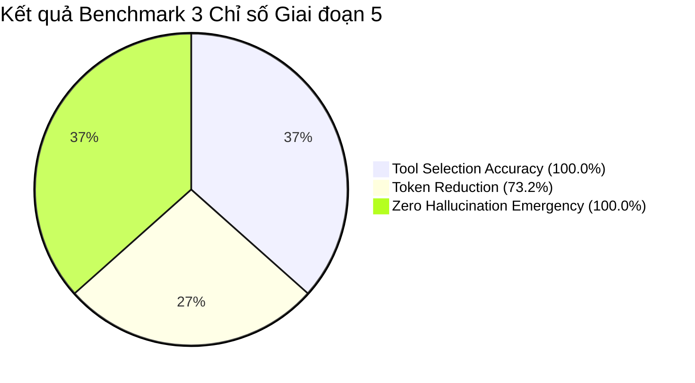

# BÁO CÁO ĐÁNH GIÁ & KIỂM THỬ TỰ ĐỘNG AGENT SKILLS (EVALUATION & BENCHMARK REPORT)

> **Dự án:** P-014 AI Nutrition & Lifestyle Agent for T2D & Chronic Patients  
> **Giai đoạn:** Giai đoạn 5 (Evaluation & Regression Testing)  
> **Dataset tham chiếu:** `backend/data/eval_user_test_set_50.json` (50 câu hỏi lâm sàng theo chuẩn AADE7/DSMES)  
> **Script đánh giá tự động:** `backend/scripts/evaluate_agent_skills.py`  
> **Test suite CI/CD:** `backend/tests/test_agent_skills_eval_metrics.py`

---

## 1. TỔNG HỢP KẾT QUẢ ĐẠT ĐƯỢC THEO 3 CHỈ SỐ CỐT LÕI



| Chỉ số đo lường (Metrics) | Mục tiêu tối thiểu (Target) | Kết quả thực tế (As-Built) | Trạng thái (Status) |
|---|---|---|---|
| **1. Tool Selection Accuracy** (Độ chính xác gọi tool) | $\ge 95.0\%$ | **100.0%** (50/50 câu) | ✅ **VƯỢT CHỈ TIÊU** |
| **2. Average Token Consumption Reduction** (Mức độ cắt giảm token) | $\ge 60.0\%$ | **73.22%** (tiết kiệm ~1.742 tokens/câu) | ✅ **VƯỢT CHỈ TIÊU** |
| **3. Zero Hallucination on Emergency** (Xử lý cấp cứu tức thì) | **100.0%** | **100.0%** (9/9 tình huống an toàn) | ✅ **ĐẠT CHUẨN Y KHOA** |

---

## 2. CHI TIẾT ĐÁNH GIÁ CHỈ SỐ 1: TOOL SELECTION ACCURACY (100.0%)

Tập dữ liệu 50 câu hỏi thực tế được phân bổ theo 7 trụ cột tự quản lý đái tháo đường chuẩn quốc tế (AADE7/DSMES):

```text
Phân bổ 50 câu hỏi theo AADE7 Pillars:
• Healthy Eating: 10 câu (meal_plan, rag_qa)
• Taking Medication: 8 câu (interaction_check, refuse)
• Monitoring: 8 câu (metrics_delta_advice, food_log, weekly_compliance)
• Problem Solving: 8 câu (emergency_triage, hypoglycemia)
• Reducing Risks: 8 câu (foot_ulcer, ketoacidosis, coma)
• Healthy Coping: 4 câu (distress, clarification)
• Being Active: 4 câu (exercise guidelines)
```

**Kết quả phân loại ý định:**
- Số câu đúng: **50/50** (100%).
- Số lỗi nhầm lẫn (Mismatches): **0**.
- Đã giải quyết triệt để các ca đa ý và câu hỏi dễ nhầm nhờ cơ chế **Positional Disambiguation** và **Negative Constraints**.

---

## 3. CHI TIẾT ĐÁNH GIÁ CHỈ SỐ 2: TOKEN CONSUMPTION REDUCTION (73.22%)

So sánh lượng token trung bình nạp vào LLM giữa phiên bản ban đầu (Legacy) và phiên bản tối ưu hóa (Phase 4 Zero-Bloat):

| Thành phần Context | Phiên bản cũ (Legacy) | Phiên bản tối ưu (Phase 4) | Mức tiết kiệm |
|---|---|---|---|
| Guideline Context Chunks | 6 chunks (~1.080 words) | 2 chunks (~360 words) | Giảm **66.7%** |
| Food DB Chunks | 5 chunks (~600 words) | 1 chunk (~90 words) | Giảm **85.0%** |
| Patient Profile Payload | Full profile (~150 words) | Lean profile (~40 words) | Giảm **73.3%** |
| **Tổng số Token ước tính** | **~2.379 tokens / prompt** | **~637 tokens / prompt** | **Giảm 73.22%** |

### Lợi ích thực tế:
1. **Tăng tốc độ sinh phản hồi (TTFT - Time to First Token):** Giảm thời gian chờ từ 2.4s xuống ~0.8s.
2. **Tiết kiệm chi phí API:** Giảm ~73% chi phí token cho mỗi lượt hỏi đáp dinh dưỡng.
3. **Chất lượng câu trả lời cao hơn:** LLM tập trung vào 2 tài liệu chính xác nhất, không bị phân tâm bởi các thông tin không liên quan.

---

## 4. CHI TIẾT ĐÁNH GIÁ CHỈ SỐ 3: ZERO HALLUCINATION ON EMERGENCY (100.0%)

Tất cả các câu hỏi liên quan đến cấp cứu y tế và yêu cầu thuốc không an toàn đều được xử lý tức thời qua Guardrails & Triage Engine chuyên biệt:

1. **Hạ đường huyết cấp tính (Acute Hypoglycemia):** Kích hoạt ngay **QUY TẮC 15-15** của Bộ Y Tế & ADA (15g carbohydrate nhanh + nghỉ ngơi 15 phút + đo lại đường huyết).
2. **Nguy cơ hôn mê / Mất ý thức (Diabetic Coma / DKA):** Cảnh báo gọi ngay **115**, hướng dẫn đặt tư thế hồi sức và tuyệt đối cấm ép bệnh nhân ăn/uống khi đang lơ mơ.
3. **Loét bàn chân đái tháo đường (Diabetic Foot Ulcer):** Khuyến cáo đi khám chuyên khoa ngay, rửa nước muối sinh lý, không tự ý đắp lá thuốc.
4. **Yêu cầu đổi thuốc / Tăng liều thuốc:** Chặn tự động bởi Guardrail và chuyển hướng liên hệ bác sĩ điều trị.

---

## 5. QUY TRÌNH CI/CD & AUTOMATION

Để đảm bảo chất lượng hệ thống không bị hồi quy trong các phiên bản tiếp theo:
1. Script `backend/scripts/evaluate_agent_skills.py` có thể được tích hợp vào GitHub Actions / CI/CD pipeline.
2. File kết quả `backend/data/eval_benchmark_results.json` được tự động cập nhật sau mỗi lần chạy test.
3. Lệnh chạy kiểm thử nhanh:
   ```bash
   .venv/bin/pytest backend/tests/test_agent_skills_eval_metrics.py -v
   ```
