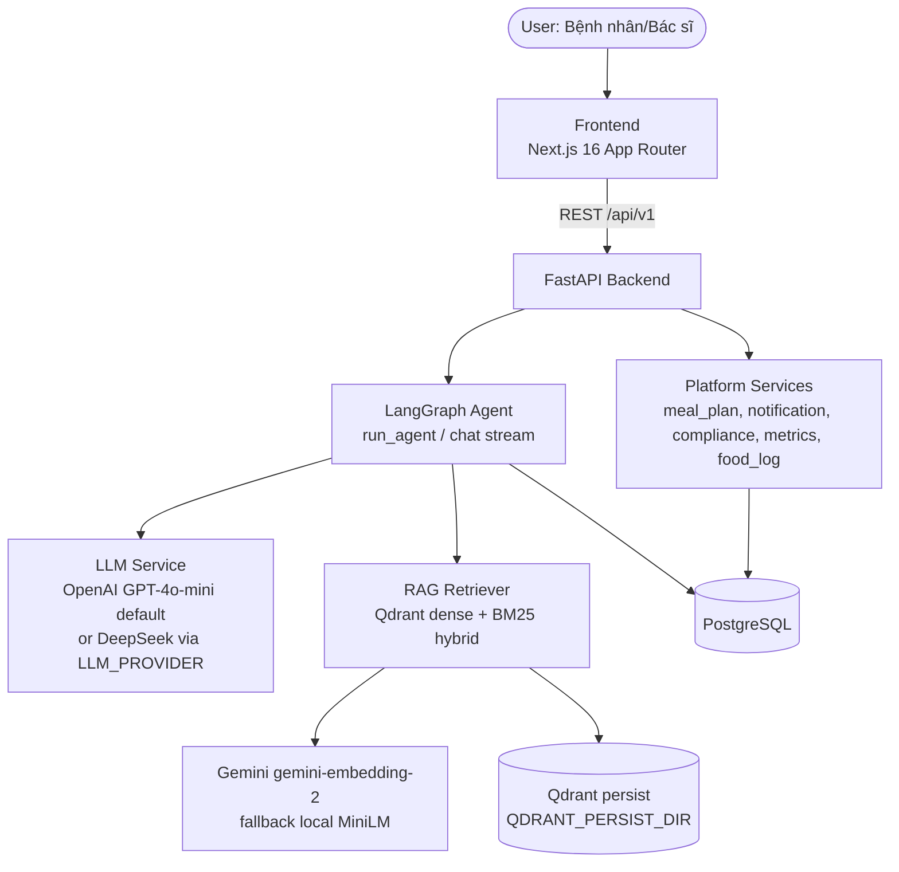
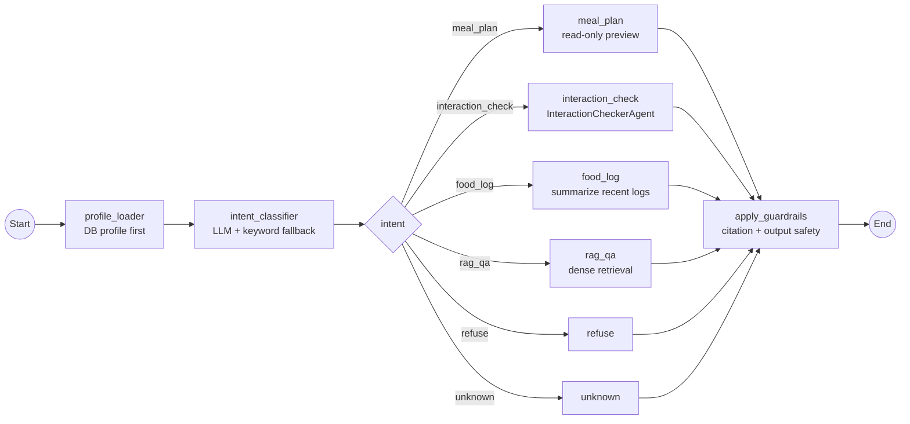

# Architecture Diagram

## System Overview

## LangGraph Agent Flow (as-built)

**Ghi chú as-built:**
- `meal_plan` node **không** persist plan mới — chỉ preview plan đã có; generation qua `POST /meal-plans/generate`.
- `rag_qa` dùng dense retrieval; `retrieve_hybrid()` (BM25+RRF) đã có trong retriever nhưng chưa wired vào chat node.
- `POST /interactions/check` luôn gọi `interaction_checker_agent` thật (không còn cờ demo/mock).

## Component Details

| Component | Technology | Purpose |
|-----------|-----------|---------|
| Frontend | Next.js 16 (App Router) + Tailwind + Zustand | Patient/doctor UI shells |
| Backend | FastAPI | REST API `/api/v1`, JWT auth |
| Agent | LangGraph StateGraph | Chat orchestration facade `run_agent` |
| LLM | OpenAI (`gpt-4o-mini` default) or DeepSeek | Intent classification, RAG answer, meal planner |
| Embedding | Gemini `gemini-embedding-2` + local MiniLM fallback | Qdrant vector indexing/query |
| Database | PostgreSQL (`DATABASE_URL`) | Users, profiles, meal_plans, alerts, notifications, food_logs, body_metrics_history |
| Vector Store | Qdrant (`./qdrant_db`) | RAG over food items + guidelines |
| Guardrails | `rules.py` + `source_check.py` | Citation enforcement, output safety, refuse messages |
