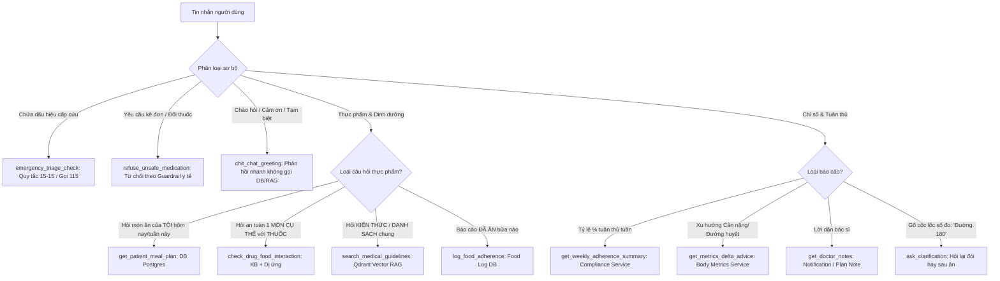

# HƯỚNG DẪN KỸ THUẬT MÔ TẢ KỸ NĂNG & RÀNG BUỘC PHỦ ĐỊNH (SKILL DESCRIPTION ENGINEERING & NEGATIVE CONSTRAINTS)

> **Dự án:** P-014 AI Nutrition & Lifestyle Agent for T2D & Chronic Patients  
> **Phiên bản:** 1.0 (Giai đoạn 3 — Modular Skills Architecture)  
> **Module liên quan:** `app.agents.skills.registry`, `app.agents.skills.primitive_skills`, `app.agents.skills.utility_skills`, `app.agents.nodes.intent_classifier`

---

## 1. TẠI SAO CẦN DESCRIPTION ENGINEERING CHO AGENT Y TẾ?

Trong các hệ thống AI Agent phức tạp (đặc biệt trong miền Y tế & Dinh dưỡng mạn tính):
1. **Hiện tượng ảo giác gọi Tool (Tool Hallucination & Over-calling):** Khi các mô tả tool quá chung chung hoặc chỉ nói về những gì tool làm được, LLM có xu hướng gọi 3–4 tool đồng thời cho một câu hỏi đơn giản (ví dụ: vừa gọi RAG, vừa gọi Meal Plan DB, vừa kiểm tra Tương tác thuốc).
2. **Hiện tượng Phình Context (Context Bloat):** Việc gọi tool tràn lan nạp hàng nghìn token không cần thiết vào context window, làm tăng latency, tốn chi phí và gây ra hiện tượng *Lost in the middle* (LLM bị loãng thông tin và trả lời sai).
3. **Giải pháp cốt lõi:** Kỹ thuật **Negative Constraints (Ràng buộc phủ định)** — Không chỉ dạy cho LLM biết *khi nào nên dùng*, mà bắt buộc phải chỉ rõ *khi nào TUYỆT ĐỐI KHÔNG ĐƯỢC DÙNG*.

---

## 2. QUY CHUẨN CẤU TRÚC 3 PHẦN CHO MỌI SKILL

Mỗi Primitive Skill và Utility Skill trong hệ thống P-014 bắt buộc phải có cấu trúc mô tả 3 phần chuẩn hóa:

```text
[MỤC ĐÍCH]:
Mô tả súc tích trong đúng 1 câu về phạm vi nghiệp vụ và hành vi cốt lõi của hàm.

[KHI NÀO DÙNG]:
Liệt kê 2-4 câu hỏi hoặc tình huống thực tế điển hình của bệnh nhân kích hoạt Skill này.

[TUYỆT ĐỐI KHÔNG DÙNG]:
Liệt kê rõ ràng các ranh giới cấm gọi (Negative Constraints) để LLM không nhầm sang Skill khác.
```

---

## 3. BẢNG DANH MỤC 11 SKILLS CHUẨN HÓA (SKILL CATALOG)

### Nhóm 1: Primitive Skills (Kỹ năng nghiệp vụ nguyên thủy)

| # | Skill Name | Category | Intent Ánh xạ | [MỤC ĐÍCH] | [KHI NÀO DÙNG] | [TUYỆT ĐỐI KHÔNG DÙNG] |
|---|---|---|---|---|---|---|
| 1 | `get_patient_meal_plan` | Primitive | `meal_plan` | Đọc và hiển thị thực đơn dinh dưỡng cá nhân hóa từ DB Postgres theo bữa/ngày/tuần. | • "Hôm nay tôi nên ăn gì?"<br>• "Cho tôi xem thực đơn sáng nay"<br>• "Bác sĩ đã lên thực đơn tuần này chưa?" | • Hỏi kiến thức chung (dùng `search_medical_guidelines`).<br>• Hỏi tương tác thuốc (dùng `check_drug_food_interaction`).<br>• Ghi nhận món vừa ăn (dùng `log_food_adherence`). |
| 2 | `check_drug_food_interaction` | Primitive | `interaction_check` | Tra cứu an toàn, tương tác giữa thuốc đang điều trị với thực phẩm cụ thể hoặc kiểm tra dị ứng. | • "Uống metformin có ăn bưởi được không?"<br>• "Tôi ăn tôm có sao không khi đang uống thuốc?"<br>• "Thuốc này có kỵ rượu không?" | • Hỏi xem thực đơn trong app (dùng `get_patient_meal_plan`).<br>• Hỏi danh sách rau quả chung.<br>• Yêu cầu kê đơn/đổi thuốc (dùng `refuse_unsafe_medication`). |
| 3 | `search_medical_guidelines` | Primitive | `rag_qa` | Tra cứu hướng dẫn lâm sàng Bộ Y Tế/ADA về dinh dưỡng, calo, chỉ số GI, đếm carb và lối sống. | • "Những loại rau nào người tiểu đường không nên ăn?"<br>• "Chỉ số GI của gạo lứt là bao nhiêu?"<br>• "Cá hồi có lợi ích gì cho đường huyết?" | • Hỏi xem thực đơn đã lưu trong app.<br>• Hỏi tương tác với thuốc cụ thể đang uống.<br>• Bệnh nhân có dấu hiệu cấp cứu hạ đường huyết. |
| 4 | `log_food_adherence` | Primitive | `food_log` | Truy xuất và tổng hợp các bản ghi nhật ký bữa ăn gần đây của bệnh nhân từ cơ sở dữ liệu. | • "Sáng nay tôi đã ăn phở bò"<br>• "Tôi vừa ăn xong bữa trưa đúng thực đơn"<br>• "Xem lại nhật ký ăn uống gần đây" | • Hỏi gợi ý thực đơn sắp tới.<br>• Tra cứu calo/dinh dưỡng món ăn.<br>• Kiểm tra tương tác thuốc. |
| 5 | `get_weekly_adherence_summary` | Primitive | `weekly_compliance` | Tính toán và báo cáo tỷ lệ (%) tuân thủ kế hoạch ăn uống cùng chuỗi theo dõi 7 ngày. | • "Tuần này tôi tuân thủ thực đơn bao nhiêu phần trăm?"<br>• "Báo cáo tuân thủ tuần này của tôi thế nào?"<br>• "Tỷ lệ tuân thủ gần đây của tôi?" | • Hỏi chi tiết món ăn hôm nay.<br>• Hỏi xu hướng cân nặng/đường huyết.<br>• Hỏi tương tác thuốc. |
| 6 | `get_metrics_delta_advice` | Primitive | `metrics_delta_advice` | So sánh xu hướng thay đổi giữa 2 lần ghi nhận chỉ số sức khỏe gần nhất và đưa ra nhận xét an toàn. | • "Dạo này cân nặng của tôi thế nào?"<br>• "Đường huyết của tôi có xu hướng tăng hay giảm?"<br>• "Chỉ số sức khỏe gần đây có ổn định không?" | • Tự ý chẩn đoán bệnh mới, tiên lượng khỏi bệnh.<br>• Kê đơn hay đổi liều thuốc.<br>• Bệnh nhân đang có triệu chứng cấp cứu nguy kịch. |
| 7 | `get_doctor_notes` | Primitive | `doctor_note` | Truy xuất lời nhắc, lời dặn hoặc ghi chú điều chỉnh lâm sàng mới nhất từ bác sĩ điều trị. | • "Bác sĩ có dặn dò gì mới không?"<br>• "Xem lời nhắc từ bác sĩ điều trị"<br>• "Bác sĩ ghi chú gì về chế độ ăn của tôi?" | • Hỏi kiến thức y khoa chung ngoài hồ sơ.<br>• Hỏi thực đơn chi tiết từng món.<br>• Hỏi tương tác thuốc. |

---

### Nhóm 2: Utility Skills (Kỹ năng bổ trợ & Xử lý ngoại lệ)

| # | Skill Name | Category | Intent Ánh xạ | [MỤC ĐÍCH] | [KHI NÀO DÙNG] | [TUYỆT ĐỐI KHÔNG DÙNG] |
|---|---|---|---|---|---|---|
| 8 | `emergency_triage_check` | Utility | `unknown` | Nhận diện và phản hồi tức thời tình trạng cấp cứu (hạ đường huyết cấp quy tắc 15-15, hôn mê 115, toan ceton, loét chân). | • "Tôi đói cồn cào, tay chân run lẩy bẩy, vã mồ hôi"<br>• "Người nhà lơ mơ gọi không tỉnh"<br>• "Vừa tiêm insulin xong thấy hoa mắt muốn ngất" | • Câu hỏi sức khỏe thông thường không nguy kịch.<br>• Tra cứu thực đơn hay tương tác thuốc hàng ngày.<br>• Chào hỏi xã giao. |
| 9 | `ask_clarification` | Utility | `unknown` | Đặt câu hỏi ngắn làm rõ khi bệnh nhân nhập dữ liệu quá ngắn/mơ hồ (chỉ gõ số đo đường) hoặc kiệt sức tâm lý. | • "Đường 180"<br>• "150"<br>• "Tôi mệt mỏi và chán nản vì phải kiêng khem nhiều quá" | • Câu hỏi đã có đủ thông tin để định tuyến vào skill chuyên biệt.<br>• Bệnh nhân đang cấp cứu hạ đường huyết. |
| 10 | `chit_chat_greeting` | Utility | `greeting` | Phản hồi nhanh chào hỏi, giới thiệu trợ lý, cảm ơn hoặc tạm biệt mà không gọi DB hay RAG. | • "Xin chào bạn"<br>• "Bạn là ai và có thể làm gì?"<br>• "Cảm ơn bạn nhiều nhé"<br>• "Tạm biệt bot" | • Tin nhắn chứa câu hỏi nghiệp vụ dinh dưỡng.<br>• Tin nhắn phản ánh triệu chứng bệnh hoặc thuốc. |
| 11 | `refuse_unsafe_medication` | Utility | `refuse` | Từ chối an toàn theo chuẩn y khoa khi người dùng yêu cầu chỉnh liều thuốc, kê đơn hoặc chẩn đoán thay bác sĩ. | • "Tăng liều metformin giúp tôi"<br>• "Kê cho tôi đơn thuốc hạ đường"<br>• "Bác sĩ kê thuốc này sai rồi, đổi thuốc khác cho tôi" | • Câu hỏi tra cứu an toàn tương tác món ăn với thuốc đang dùng.<br>• Câu hỏi kiến thức tác dụng nhóm thuốc. |

---

## 4. MA TRẬN PHÂN BIỆT Ý ĐỊNH DỄ NHẦM LẪN (DISAMBIGUATION MATRIX)



### Các cặp phân biệt quan trọng (Negative Constraints in Action):

1. **`rag_qa` vs `interaction_check`:**
   - *"Những loại rau nào tôi không được ăn?"* $\rightarrow$ **`rag_qa`** (Hỏi danh sách kiến thức dinh dưỡng tổng quát).
   - *"Tôi ăn rau muống có sao không khi đang uống Warfarin?"* $\rightarrow$ **`interaction_check`** (Hỏi tương tác giữa thuốc cụ thể và thực phẩm cụ thể).
   - *"Ăn bưởi có được không?"* $\rightarrow$ **`interaction_check`** (Kiểm tra an toàn thực phẩm cụ thể với đơn thuốc người bệnh).

2. **`meal_plan` vs `rag_qa`:**
   - *"Hôm nay ăn gì?"* / *"Thực đơn sáng nay có món gì?"* $\rightarrow$ **`meal_plan`** (Đọc thực đơn cá nhân hóa đã được bác sĩ/hệ thống thiết lập trong DB).
   - *"Người tiểu đường ăn gì tốt cho đường huyết?"* $\rightarrow$ **`rag_qa`** (Tra cứu hướng dẫn lâm sàng về các nhóm chất dinh dưỡng).

3. **`food_log` vs `meal_plan`:**
   - *"Sáng nay tôi đã ăn một bát phở bò"* $\rightarrow$ **`food_log`** (Ghi nhận bữa ăn ĐÃ ĂN).
   - *"Sáng nay tôi nên ăn gì?"* $\rightarrow$ **`meal_plan`** (Tra cứu thực đơn SẼ ĂN).

---

## 5. CƠ CHẾ SINH OPENAI / LANGCHAIN TOOL SCHEMA

Trong module `app.agents.skills.registry`, mỗi `SkillDefinition` cung cấp phương thức:
- `to_standard_description()`: Tạo mô tả chuẩn 3 phần cho docstring và tài liệu.
- `to_prompt_block()`: Xuất khối mô tả kèm Negative Constraints cho prompt phân loại ý định của LLM.
- `to_openai_tool_schema()`: Xuất cấu trúc JSON Schema chuẩn cho OpenAI Function Calling / LangChain Dynamic Tool Binding.

Ví dụ schema được sinh tự động cho `get_patient_meal_plan`:
```json
{
  "type": "function",
  "function": {
    "name": "get_patient_meal_plan",
    "description": "Đọc và hiển thị thực đơn dinh dưỡng cá nhân hóa của bệnh nhân từ cơ sở dữ liệu theo bữa/ngày/tuần mà không tạo mới hay gọi RAG.\n\nKHI NÀO DÙNG:\n- Hôm nay tôi nên ăn gì?\n- Cho tôi xem thực đơn sáng nay\n- Bác sĩ đã lên thực đơn tuần này cho tôi chưa?\n- Trưa nay có món gì trong thực đơn?\n\nTUYỆT ĐỐI KHÔNG DÙNG (NEGATIVE CONSTRAINTS):\n- Hỏi kiến thức dinh dưỡng tổng quát hoặc danh sách nhóm thực phẩm.\n- Hỏi kiểm tra an toàn hay tương tác của một món ăn cụ thể với thuốc đang uống.\n- Ghi nhận món bệnh nhân vừa ăn xong.",
    "parameters": {
      "type": "object",
      "properties": {
        "message": {
          "type": "string",
          "description": "Tin nhắn người dùng chứa slot bữa ăn (sáng, trưa, tối)."
        }
      },
      "required": []
    }
  }
}
```

---

## 6. QUY TRÌNH BỔ SUNG SKILL MỚI (CHECKLIST CHO DEVELOPER)

Khi bổ sung kỹ năng mới vào hệ thống P-014:
1. [ ] Khai báo hàm nghiệp vụ nguyên tử (Atomic Function) trong `primitive_skills.py` hoặc `utility_skills.py`.
2. [ ] Viết docstring theo đúng chuẩn 3 phần (`[MỤC ĐÍCH]`, `[KHI NÀO DÙNG]`, `[TUYỆT ĐỐI KHÔNG DÙNG]`).
3. [ ] Đăng ký `SkillDefinition` vào `SKILL_REGISTRY` trong `registry.py`.
4. [ ] Khai báo ít nhất 2 Negative Constraints chỉ rõ các tool khác mà skill này không được phép lấn sân.
5. [ ] Viết unit test trong `tests/test_skill_descriptions.py` để xác nhận schema và prompt generation hoạt động chính xác.
