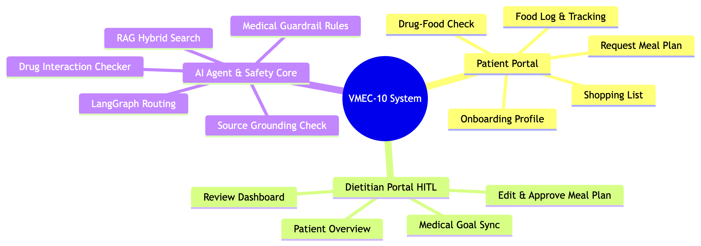
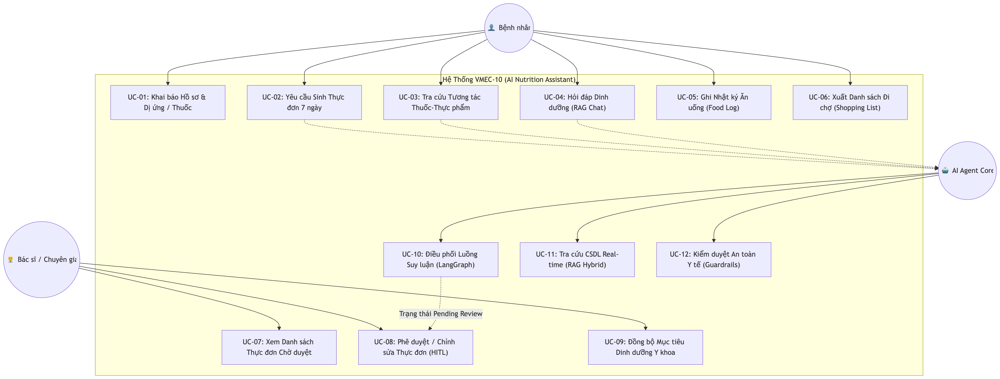
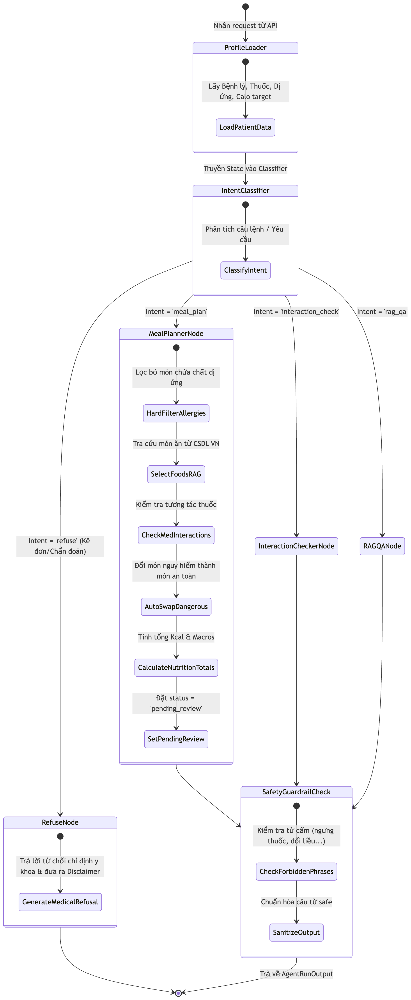
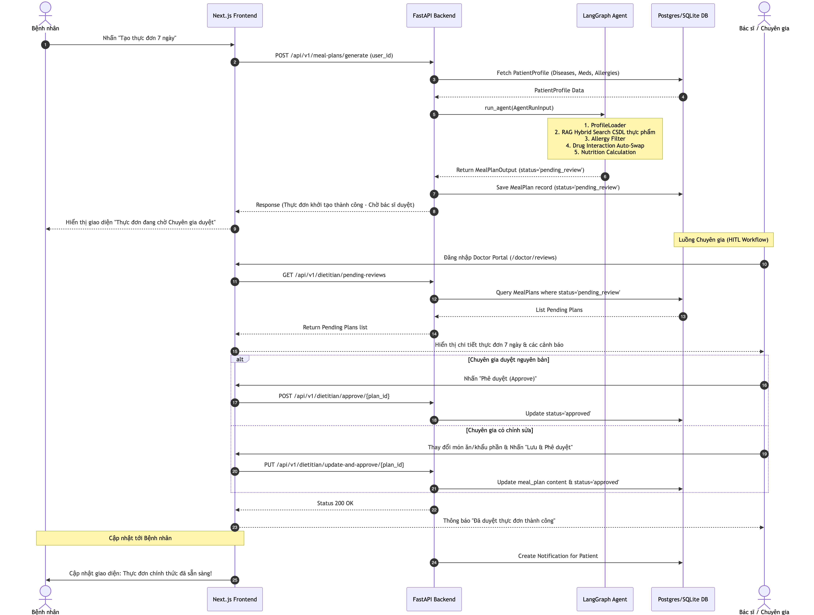
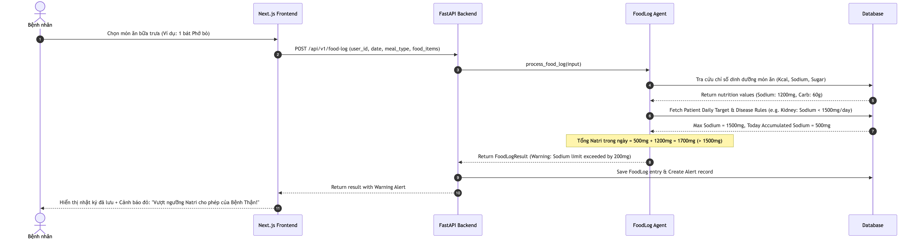
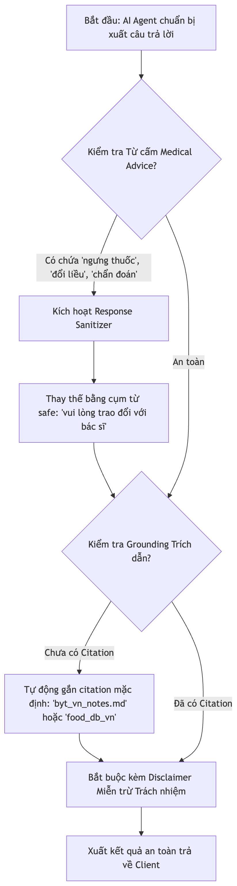

# 📘 TÀI LIỆU MÔ TẢ HỆ THỐNG & KỊCH BẢN SỬ DỤNG
## Dự án: VMEC-10 — AI Agent Trợ Lý Dinh Dưỡng & Lối Sống Theo Bệnh Lý

## 1. Danh Mục Chức Năng Hệ Thống (System Feature Matrix)

Hệ thống phục vụ **2 vai trò chính (Actors)**: **Bệnh nhân (Patient)** và **Chuyên gia Dinh dưỡng / Bác sĩ (Dietitian/Doctor)** dưới sự điều phối của **AI Agent Core**.

### 1.1. Phân loại Tính năng Chi tiết

| ID | Tên Chức năng | Vai trò chính | Phân loại | Trạng thái Repo | Mô tả chi tiết |
| :--- | :--- | :--- | :---: | :---: | :--- |
| **F-01** | Khai báo Hồ sơ & Ràng buộc Bệnh lý | Bệnh nhân | Cơ bản | 🟢 Đã có | Nhập chiều cao, cân nặng, bệnh lý (Tiểu đường, Tim mạch, Thận, Gout), danh sách thuốc đang dùng, dị ứng, mức độ vận động. |
| **F-02** | Sinh Thực đơn 7 ngày Y khoa | Bệnh nhân / AI Agent | Cơ bản | 🟢 Đã có | AI Agent tự động tính toán nhu cầu Kcal, Macronutrients (Carb/Protein/Fat/Sodium), tra cứu CSDL thực phẩm VN và sinh thực đơn 7 ngày có trích dẫn nguồn. |
| **F-03** | Tự động Đổi món Tương tác Thuốc (Auto-Swap) | AI Agent | Cơ bản | 🟢 Đã có | Tự động phát hiện món ăn tương tác nguy hiểm với thuốc bệnh nhân đang dùng (ví dụ: bưởi + thuốc hạ áp) và thay thế bằng món an toàn cùng nhóm. |
| **F-04** | Kiểm tra Tương tác Thuốc - Thực phẩm | Bệnh nhân / AI Agent | Cơ bản | 🟢 Đã có | Cho phép bệnh nhân tra cứu chủ động một hoặc nhiều món ăn xem có kỵ với thuốc mình đang dùng hay không. |
| **F-05** | Duyệt & Phê duyệt Thực đơn (HITL) | Bác sĩ / Chuyên gia | Cơ bản / HITL | 🟢 Đã có | Chuyên gia xem danh sách thực đơn do AI khởi tạo, phê duyệt (Approve) hoặc chỉnh sửa (Edit) trước khi áp dụng chính thức cho bệnh nhân. |
| **F-06** | Hộp thoại Chat Trợ lý AI (RAG QA) | Bệnh nhân / AI Agent | Cơ bản | 🟢 Đã có | Hỏi đáp về kiến thức dinh dưỡng y khoa grounded trên guideline y tế (ADA, Bộ Y tế). Chặn chỉ định y khoa/kê đơn. |
| **F-07** | Ghi Nhật ký Ăn uống (Food Log) | Bệnh nhân | Cơ bản | 🔴 **Cần code** | Bệnh nhân chụp ảnh/nhập món ăn thực tế đã ăn trong ngày để hệ thống tích lũy dữ liệu dinh dưỡng thực tế. |
| **F-08** | Cảnh báo Vượt ngưỡng Muối / Đường theo Bệnh lý | AI Agent | Nâng cao | 🟡 **Cần nâng cấp** | Cảnh báo đỏ khi tổng lượng Natri vượt ngưỡng cho bệnh nhân Tim mạch/Thận ($<2000\text{mg/ngày}$) hoặc lượng Đường vượt ngưỡng cho Tiểu đường. |
| **F-09** | Tạo Danh sách Đi chợ (Shopping List) | Bệnh nhân | Nâng cao | 🔴 **Cần code** | Gom tổng hợp toàn bộ nguyên liệu của thực đơn 7 ngày đã duyệt thành danh sách phân loại (Rau, Thịt, Gia vị...) để đi chợ. |
| **F-10** | Phân tích Xu hướng Dinh dưỡng (Nutrition Analytics) | Bệnh nhân / Bác sĩ | Nâng cao | 🔴 **Cần code** | Biểu đồ theo dõi xu hướng nạp Kcal, Muối, Đường thực tế so với mục tiêu bác sĩ đề ra theo tuần/tháng. |
| **F-11** | Memory Sở thích & Nguyên liệu Tủ lạnh | AI Agent | Nâng cao | 🔴 **Cần code** | Ghi nhớ món ăn yêu thích/ghét và tận dụng nguyên liệu đang có sẵn trong tủ lạnh (pantry) khi lập thực đơn. |
| **F-12** | Guardrail Kiểm tra Nguồn (Source Check) | AI Agent Guardrail | Nâng cao | 🔴 **Cần code** | Tự động kiểm tra chéo số liệu Calo/Đường/Muối trong phản hồi AI xem có đúng 100% với CSDL thực phẩm hay không. |

---

## 2. Kịch Bản Sử Dụng Thực Tế (Use Case Scenarios)

### 📌 Kịch bản 1: Onboarding & Sinh Thực Đơn 7 Ngày (Bệnh nhân Bác sĩ HITL)
* **Actor**: Bệnh nhân Nguyễn Văn A (55 tuổi, Bệnh lý: **Tiểu đường Type 2 + Tim mạch**, Thuốc: **Metformin, Atorvastatin**, Dị ứng: **Hải sản**).
* **Luồng từng bước**:
  1. **Bước 1 (Nhập hồ sơ)**: Bệnh nhân đăng nhập vào hệ thống, hoàn thành Form Onboarding nhập thông tin chỉ số cơ thể, bệnh lý, thuốc đang dùng và dị ứng hải sản.
  2. **Bước 2 (Gửi yêu cầu)**: Bệnh nhân nhấn nút *"Tạo thực đơn 7 ngày chuẩn y khoa"*.
  3. **Bước 3 (AI Agent xử lý)**:
     - Agent phân tích nhu cầu Kcal ($1800\text{ kcal/ngày}$).
     - Lọc bỏ cứng các món hải sản (do dị ứng).
     - Tra CSDL thực phẩm Việt Nam chọn các món chỉ số GI thấp (Cơm gạo lứt, ức gà, rau cải...).
     - Phát hiện bưởi kỵ với Atorvastatin $\rightarrow$ Tự động đổi bưởi thành táo tây (Auto-swap).
     - Gán nhãn trích dẫn `ada_diabetes.md` và `food_db_vn#thit_ga`.
     - Đặt trạng thái thực đơn: `pending_review` (Chờ chuyên gia duyệt).
  4. **Bước 4 (Chuyên gia thẩm định - HITL)**:
     - Bác sĩ Dinh dưỡng đăng nhập vào Bảng điều khiển Chuyên gia ([`/doctor/reviews`](file:///Users/nguyenthientai/Documents/VINAI/P-014/frontend/app/doctor/reviews/page.tsx)).
     - Xem chi tiết thực đơn 7 ngày của bệnh nhân A, kiểm tra cảnh báo dị ứng và món auto-swap.
     - Bác sĩ điều chỉnh giảm $10\text{g}$ cơm ở bữa tối và nhấn **"Phê duyệt (Approve)"**.
  5. **Bước 5 (Nhận kết quả)**: Thực đơn chuyển trạng thái `approved`. Bệnh nhân nhận thông báo và xem thực đơn hoàn chỉnh trên ứng dụng.

---

### 📌 Kịch bản 2: Tra Cứu Tương Tác Thuốc - Thực Phẩm Khẩn Cấp
* **Actor**: Bệnh nhân B.
* **Luồng từng bước**:
  1. Bệnh nhân B mở ứng dụng và gõ vào ô chat: *"Tôi đang uống thuốc huyết áp Amlodipine, hôm nay ăn bưởi da xanh hoặc uống nước ép bưởi có sao không?"*.
  2. Frontend gửi request tới API `/api/v1/chat`.
  3. LangGraph Intent Classifier phân loại ý định: `interaction_check`.
  4. Agent kích hoạt `InteractionCheckerAgent`:
     - Trích xuất Thuốc: `Amlodipine`, Thực phẩm: `bưởi`.
     - Tra CSDL `drug_food_interactions.json`.
     - Phát hiện tương tác mức độ **[Nguy hiểm]**: Bưởi làm tăng nồng độ Amlodipine trong máu, gây hạ huyết áp quá mức.
  5. Agent áp dụng Guardrail Rules: Đưa ra cảnh báo nguy hiểm, hướng dẫn tránh ăn bưởi gần thời gian uống thuốc, và đính kèm Disclaimer *"Vui lòng tham vấn bác sĩ nếu xuất hiện triệu chứng chóng mặt"*.

---

### 📌 Kịch bản 3: Ghi Nhật Ký Ăn Uống & Cảnh Báo Vượt Ngưỡng (Food Log & Alert)
* **Actor**: Bệnh nhân C (Bệnh Thận mãn tính, giới hạn Natri $<1500\text{mg/ngày}$).
* **Luồng từng bước**:
  1. Sau bữa trưa, Bệnh nhân C mở mục Nhật ký ăn uống (`/patient/meals/log`) chọn món *"Bún nước lèo"* và *"Chả giò"*.
  2. API tính toán tổng lượng Natri trong 2 món ăn này là $1800\text{mg}$.
  3. Hệ thống so sánh với ngưỡng bệnh lý Thận ($1500\text{mg}$) $\rightarrow$ Phát hiện **Vượt ngưỡng Natri khẩn cấp (+300mg)**.
  4. Hệ thống hiển thị cảnh báo đỏ trên màn hình bệnh nhân: *"⚠️ Cảnh báo: Bữa ăn trưa chứa lượng Natri vượt ngưỡng cho phép đối với bệnh Thận. Khuyên dùng thêm nhiều nước và giảm mặn bữa tối."* Đồng thời gửi thông báo tới Bác sĩ theo dõi.

---

## 📐 3. Các Sơ Đồ UML & Luồng Hoạt Động (UML Diagrams)

### 3.1. Sơ đồ Use Case Tổng quan (UML Use Case Diagram)

---

### 3.2. Luồng Điều Phối AI Agent Nội Bộ (LangGraph State Machine Diagram)

---

### 3.3. Sequence Diagram 1: Luồng Sinh Thực Đơn 7 Ngày & Phê Duyệt HITL

---

### 3.4. Sequence Diagram 2: Luồng Ghi Nhật Ký Ăn Uống & Cảnh Báo Vượt Ngưỡng (Food Log)

---

### 3.5. Activity Diagram: Luồng Kiểm Duyệt An Toàn Y Tế (Guardrails Flow)

---

