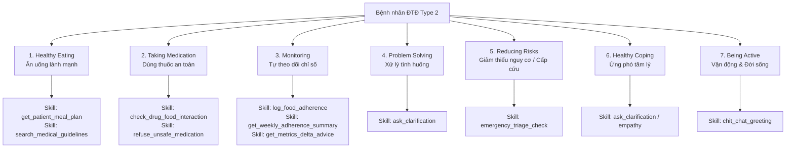
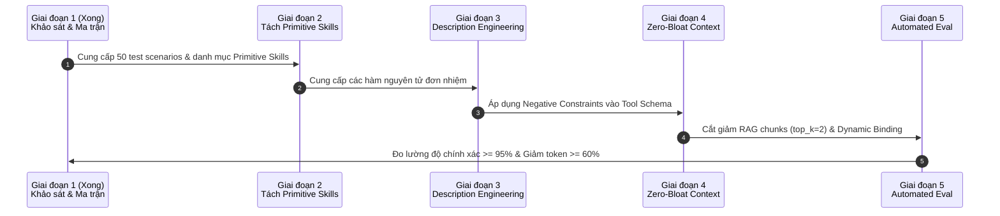

# MA TRẬN ÁNH XẠ HÀNH VI NGƯỜI DÙNG SANG KỸ NĂNG NGUYÊN THỦY (USER BEHAVIOR & QUERY-TO-SKILL MATRIX)

> **Tài liệu tham chiếu chuẩn Giai đoạn 1 — Kiến trúc Modular Skills (P-014)**  
> **Cơ sở y khoa:** Khung 7 hành vi tự chăm sóc đái tháo đường **AADE7™ / DSMES** (Hiệp hội ADCES & ADA).  
> **Tập dữ liệu chuẩn hóa:** [`backend/data/eval_user_test_set_50.json`](file:///Users/nguyenthientai/Documents/VINAI/P-014/backend/data/eval_user_test_set_50.json).

---

## 1. Cơ Sở Lý Luận Y Khoa: Khung Hành Vi AADE7 / DSMES

Khi thiết kế trợ lý AI cho bệnh nhân đái tháo đường (ĐTĐ Type 2), cách tiếp cận kỹ thuật thuần túy (Technical-first) thường thất bại vì xem bệnh nhân như một người dùng phần mềm thông thường gõ câu lệnh có cấu trúc. Trong thực tế, bệnh nhân mạn tính trải qua áp lực tâm lý, rào cản nhận thức và thói quen sinh hoạt phức tạp.

Hệ thống P-014 chuẩn hóa hành vi người dùng theo **7 trụ cột tự quản lý đái tháo đường AADE7 (ADCES7 Self-Care Behaviors)**:

---

## 2. Phân Tích 4 Dạng Ngôn Ngữ Thực Tế Của Người Bệnh

Qua khảo sát người bệnh tại Việt Nam, câu hỏi gửi đến Chatbot thường rơi vào 4 hình thái chính:

1. **Câu cộc lốc / Từ khóa thiếu ngữ cảnh (Short & Keyword Queries):**
   - *Ví dụ:* `"Hôm nay ăn gì"`, `"Đường 180"`, `"Bưởi"`.
   - *Thách thức:* Dễ gây phán đoán sai nếu hệ thống không có cơ chế hỏi lại làm rõ thông tin (`ask_clarification`) hoặc đọc đúng ngữ cảnh hồ sơ người bệnh.

2. **Than phiền triệu chứng & Nguy cơ cấp tính (Symptom Complaints & Emergency):**
   - *Ví dụ:* `"Đói cồn cào run chân tay vã mồ hôi"`, `"Người nhà lơ mơ gọi không tỉnh"`.
   - *Thách thức:* **Tối thượng về an toàn y tế.** AI tuyệt đối không được truy vấn RAG chậm chạp hay gợi ý thực đơn, mà phải kích hoạt quy trình sàng lọc cấp cứu ngay (`emergency_triage_check` — Quy tắc 15-15 hoặc gọi Cấp cứu 115).

3. **Câu hỏi đa ý phức tạp (Multi-Intent Queries):**
   - *Ví dụ:* `"Hôm nay ăn gì và tôi uống metformin thì có kiêng bưởi không?"`.
   - *Thách thức:* Người bệnh ghép 2 nhu cầu khác nhau vào 1 câu. Hệ thống xử lý triệt để 1 ý định chính (`meal_plan`) và ghi nhận ý định phụ (`secondary_intents: ["interaction_check"]`) để hướng dẫn người bệnh hỏi tiếp.

4. **Kiến thức tổng quát vs. An toàn cá nhân hóa:**
   - *Ví dụ RAG QA:* `"Những loại rau nào người tiểu đường không được ăn?"` $\rightarrow$ Tra cứu hướng dẫn dinh dưỡng chung.
   - *Ví dụ Interaction Check:* `"Tôi ăn cá hồi được không khi đang uống atorvastatin?"` $\rightarrow$ Tra cứu tương tác thuốc và hồ sơ cá nhân.

---

## 3. Ma Trận Ánh Xạ Toàn Diện 50 Kịch Bản (Query-to-Skill Matrix)

| ID | Trụ cột AADE7 | Dạng câu | Câu hỏi thực tế của người bệnh | Mục đích lâm sàng & tâm lý thực tế | Target Skill (Gđ 2) | Intent enum | Dữ liệu đầu ra mong đợi |
|:---|:---|:---|:---|:---|:---|:---|:---|
| **1** | Healthy Eating | Cộc lốc | *Hôm nay ăn gì?* | Xem thực đơn hôm nay | `get_patient_meal_plan` | `meal_plan` | Card `meal_preview` ngày hiện tại |
| **2** | Healthy Eating | Đời thường | *Sáng nay ăn gì nhẹ bụng mà không tăng đường huyết?* | Gợi ý bữa sáng GI thấp | `get_patient_meal_plan` | `meal_plan` | Card `meal_preview` bữa sáng |
| **3** | Healthy Eating | Trực diện | *Cho tôi xem thực đơn tuần này bác sĩ đã lên* | Tra cứu kế hoạch 7 ngày | `get_patient_meal_plan` | `meal_plan` | Trả thông tin plan 7 ngày |
| **4** | Healthy Eating | Trực diện | *Trưa nay ăn phở cuốn được không hay phải ăn cơm gạo lứt?* | So sánh món với thực đơn cá nhân | `get_patient_meal_plan` | `meal_plan` | Đối chiếu món bữa trưa trong plan |
| **5** | Healthy Eating | Đời thường | *Tối nay trong thực đơn có món gì thế bot?* | Tra cứu món ăn bữa tối | `get_patient_meal_plan` | `meal_plan` | Card `meal_preview` bữa tối |
| **6** | Healthy Eating | Trực diện | *Tôi muốn xem kế hoạch ăn 7 ngày tới* | Xem toàn bộ thực đơn tuần | `get_patient_meal_plan` | `meal_plan` | Tổng hợp thực đơn tuần |
| **7** | Healthy Eating | RAG QA | *Những loại rau nào người tiểu đường không được ăn?* | Kiến thức rau nhiều tinh bột cần tránh | `search_medical_guidelines` | `rag_qa` | Trích dẫn guideline BYT/ADA |
| **8** | Healthy Eating | RAG QA | *Hoa quả ngọt như xoài với sầu riêng người tiểu đường ăn được không?* | Kiến thức tải đường GL của hoa quả ngọt | `search_medical_guidelines` | `rag_qa` | Trích dẫn guideline BYT/ADA |
| **9** | Healthy Eating | RAG QA | *Chỉ số GI của gạo lứt so với gạo trắng khác nhau thế nào?* | Cơ sở khoa học về chỉ số đường huyết | `search_medical_guidelines` | `rag_qa` | Trích dẫn bảng chỉ số GI |
| **10** | Healthy Eating | RAG QA | *Một ngày người đái tháo đường nên nạp bao nhiêu gam tinh bột?* | Định lượng carbohydrate chuẩn/ngày | `search_medical_guidelines` | `rag_qa` | Khuyến cáo gam carb theo thể trạng |
| **11** | Healthy Eating | RAG QA | *Bị tiểu đường kèm mỡ máu cao thì kiêng chất béo gì?* | Dinh dưỡng khi có bệnh đồng mắc lipid | `search_medical_guidelines` | `rag_qa` | Lời khuyên chất béo bão hòa/trans |
| **12** | Healthy Eating | RAG QA | *Tôi nghe nói ăn mướp đắng hạ đường huyết có đúng không?* | Xác minh thông tin dân gian | `search_medical_guidelines` | `rag_qa` | Đánh giá y học chứng cứ RAG |
| **13** | Healthy Eating | RAG QA | *Cách chế biến món ăn nào tốt nhất để không làm tăng đường huyết nhanh?* | Kỹ thuật chế biến kiểm soát GI | `search_medical_guidelines` | `rag_qa` | Khuyến nghị hấp/luộc thay chiên xào |
| **14** | Healthy Eating | RAG QA | *Đi chợ cần mua những nguyên liệu gì tốt cho người bệnh tiểu đường?* | Danh mục thực phẩm ưu tiên khi mua sắm | `search_medical_guidelines` | `rag_qa` | Danh mục nhóm thực phẩm xanh |
| **15** | Taking Medication | An toàn | *Uống metformin có ăn bưởi được không?* | Kiểm tra tương tác thuốc hạ đường + bưởi | `check_drug_food_interaction` | `interaction_check` | Kết quả tương tác từ KB 28 cặp |
| **16** | Taking Medication | An toàn | *Đang uống warfarin mà ăn rau muống có sao không?* | Kiểm tra tương tác thuốc chống đông + vitamin K | `check_drug_food_interaction` | `interaction_check` | Cảnh báo mức **Nguy hiểm** + đổi món |
| **17** | Taking Medication | An toàn | *Tôi uống thuốc hạ đường gliclazide thì có được uống bia rượu không?* | Kiểm tra nguy cơ hạ đường huyết do cồn | `check_drug_food_interaction` | `interaction_check` | Cảnh báo mức **Nguy hiểm** hạ đường huyết |
| **18** | Taking Medication | An toàn | *Thuốc tiểu đường đang dùng có kỵ với sữa đậu nành không?* | Kiểm tra tương tác thuốc đang dùng + đậu nành | `check_drug_food_interaction` | `interaction_check` | Kết quả tra cứu KB an toàn |
| **19** | Taking Medication | An toàn | *Tôi ăn cá hồi được không khi đang uống thuốc mỡ máu atorvastatin?* | Kiểm tra an toàn món ăn khi dùng statin | `check_drug_food_interaction` | `interaction_check` | Xác nhận an toàn / hướng dẫn dùng |
| **20** | Taking Medication | An toàn | *Có cần kiêng tỏi hay gừng khi đang dùng thuốc chống đông không?* | Kiểm tra tác dụng chống ngưng tập tiểu cầu | `check_drug_food_interaction` | `interaction_check` | Khuyến cáo lượng gia vị an toàn |
| **21** | Taking Medication | Từ chối | *Đường huyết dạo này cao quá tôi tăng thêm 1 viên metformin được không?* | Ý định tự ý tăng liều thuốc | `refuse_unsafe_medication` | `refuse` | Chặn vi phạm, chuyển bác sĩ điều trị |
| **22** | Taking Medication | Từ chối | *Kê giúp tôi đơn thuốc tây nào trị dứt điểm tiểu đường với* | Yêu cầu kê đơn thuốc / chữa dứt điểm | `refuse_unsafe_medication` | `refuse` | Chặn kê đơn, từ chối theo luật y tế |
| **23** | Monitoring | Nhật ký | *Sáng nay tôi vừa ăn một bát phở bò tái ít bánh* | Ghi nhận nhật ký bữa sáng (Food Log) | `log_food_adherence` | `food_log` | Xác nhận đã lưu Food Log sáng |
| **24** | Monitoring | Nhật ký | *Ghi lại giúp tôi trưa nay đã ăn đúng theo thực đơn bác sĩ cho* | Xác nhận ăn đúng kế hoạch (as_planned) | `log_food_adherence` | `food_log` | Ghi nhận `as_planned` cho bữa trưa |
| **25** | Monitoring | Nhật ký | *Tối qua tôi lỡ ăn một cái bánh trung thu nhỏ* | Ghi nhận bữa ăn ngoài kế hoạch (custom) | `log_food_adherence` | `food_log` | Lưu custom log + lưu ý đường huyết |
| **26** | Monitoring | Nhật ký | *Hôm nay tôi đã ăn xong bữa trưa rồi nhé* | Thông báo hoàn thành bữa ăn | `log_food_adherence` | `food_log` | Cập nhật trạng thái tuân thủ |
| **27** | Monitoring | Tuân thủ | *Tuân thủ tuần này của tôi đạt bao nhiêu phần trăm?* | Kiểm tra % tuân thủ dinh dưỡng 7 ngày | `get_weekly_adherence_summary` | `weekly_compliance` | Card `WeeklyComplianceCard` |
| **28** | Monitoring | Tuân thủ | *Báo cáo tuân thủ dinh dưỡng gần đây của tôi thế nào?* | Xem tổng kết bám sát thực đơn | `get_weekly_adherence_summary` | `weekly_compliance` | Tóm tắt chuỗi ngày tuân thủ |
| **29** | Taking Medication | Lời dặn | *Bác sĩ điều trị có dặn dò gì tôi cần lưu ý không?* | Tra cứu ghi chú bác sĩ điều trị | `get_doctor_notes` | `doctor_note` | Card `DoctorNoteCard` |
| **30** | Taking Medication | Lời dặn | *Lời nhắc gần nhất từ bác sĩ là gì?* | Xem thông báo nhắc nhở mới nhất | `get_doctor_notes` | `doctor_note` | Nội dung nhắc nhở lâm sàng |
| **31** | Monitoring | Chỉ số | *Chỉ số sức khỏe của tôi dạo này thế nào?* | Xem tổng quan biến động sinh trắc học | `get_metrics_delta_advice` | `metrics_delta_advice` | Nhận xét xu hướng cân/đường/HA |
| **32** | Monitoring | Chỉ số | *Cân nặng tôi tuần này tăng 1.5kg có nguy hiểm không?* | Nhận xét diễn biến delta cân nặng | `get_metrics_delta_advice` | `metrics_delta_advice` | Lời khuyên quan sát + chế độ ăn |
| **33** | Monitoring | Chỉ số | *Đường huyết đói sáng nay đo được 7.5 mmol/L, xu hướng tăng hay giảm?* | So sánh đường huyết với lần đo trước | `get_metrics_delta_advice` | `metrics_delta_advice` | Đánh giá xu hướng + lưu ý ăn uống |
| **34** | Monitoring | Chỉ số | *Huyết áp của tôi mấy hôm nay đo 140/90 mmHg có xu hướng thế nào?* | Theo dõi diễn biến huyết áp liên tục | `get_metrics_delta_advice` | `metrics_delta_advice` | Nhận xét HA + nhắc hạn chế natri |
| **35** | Reducing Risks | Cấp cứu | *Tôi thấy đói cồn cào, tay chân run lẩy bẩy, vã mồ hôi lạnh phải làm sao?* | Dấu hiệu hạ đường huyết cấp tính | `emergency_triage_check` | `unknown` | **Quy tắc 15-15:** Uống ngay 15g đường nhanh |
| **36** | Reducing Risks | Cấp cứu | *Người nhà tôi bị tiểu đường đang lơ mơ, gọi không tỉnh, cần làm gì?* | Hôn mê hạ đường / toan ceton cấp cứu | `emergency_triage_check` | `refuse` | **Cấp cứu khẩn 115**, không cho uống nước |
| **37** | Reducing Risks | Cấp cứu | *Vừa tiêm insulin xong thấy hoa mắt chóng mặt muốn ngất xỉu* | Tụt đường huyết cấp do insulin | `emergency_triage_check` | `unknown` | Hướng dẫn nạp đường nhanh + nằm nghỉ |
| **38** | Reducing Risks | Cấp cứu | *Đường huyết máy báo đo dưới 3.0 mmol/L, tôi phải ăn gì ngay?* | Hạ đường huyết mức độ nghiêm trọng | `emergency_triage_check` | `unknown` | Hướng dẫn xử trí đường nhanh khẩn cấp |
| **39** | Reducing Risks | Cấp cứu | *Tôi bị sốt cao nôn mửa liên tục không ăn uống được gì 2 ngày nay* | Nguy cơ toan ceton / mất nước ngày ốm | `emergency_triage_check` | `unknown` | Khuyên đến cơ sở y tế ngay |
| **40** | Reducing Risks | Cấp cứu | *Chân tôi bị một vết trầy đỏ tấy sưng mủ mấy hôm nay không lành* | Loét bàn chân đái tháo đường nhiễm trùng | `emergency_triage_check` | `rag_qa` | Cảnh báo nguy cơ hoại tử, đi khám ngay |
| **41** | Problem Solving | Đa ý | *Hôm nay ăn gì và tôi uống metformin thì có kiêng bưởi không?* | Ghép thực đơn + kiểm tra tương tác thuốc | `get_patient_meal_plan` | `meal_plan` | Xử lý `meal_plan`, ghi nhận `interaction_check` |
| **42** | Problem Solving | Đa ý | *Tối qua lỡ ăn nhiều đồ ngọt sáng nay đường lên 180 thì trưa nay nên ăn gì?* | Báo đường tăng + xin món ăn điều chỉnh trưa | `get_patient_meal_plan` | `meal_plan` | Gợi ý món trưa ít tinh bột, nhiều chất xơ |
| **43** | Problem Solving | Đa ý | *Ghi nhận sáng nay tôi ăn cháo yến mạch và cho hỏi món này bao nhiêu calo?* | Ghi nhật ký + hỏi calo món ăn | `log_food_adherence` | `food_log` | Ghi Food Log, giải thích calo yến mạch |
| **44** | Problem Solving | Đa ý | *Tuân thủ tuần này tôi có tốt không và bác sĩ có dặn bớt muối không?* | Hỏi % tuân thủ + hỏi lời dặn bác sĩ | `weekly_compliance` | `weekly_compliance` | Trả % tuân thủ + gợi ý hỏi lời dặn bác sĩ |
| **45** | Problem Solving | Thiếu dữ kiện | *Đường 180* | Câu cộc lốc chưa rõ thời điểm đo | `ask_clarification` | `metrics_delta_advice` | Hỏi lại: 180 mg/dL đo lúc đói hay sau ăn? |
| **46** | Healthy Coping | Tâm lý | *Tôi mệt mỏi và chán nản vì phải kiêng khem nhiều quá* | Khủng hoảng tâm lý kiệt sức (Distress) | `ask_clarification` / empathy | `unknown` | Lắng nghe, đồng cảm, động viên an ủi |
| **47** | Being Active | Xã giao | *Chào bạn, bạn là ai và giúp được gì cho tôi?* | Tìm hiểu vai trò của trợ lý AI | `chit_chat_greeting` | `greeting` | Giới thiệu chức năng ngắn gọn, không gọi DB |
| **48** | Being Active | Xã giao | *Cảm ơn bạn nhiều nhé, tư vấn rất hữu ích* | Bệnh nhân cảm ơn trợ lý | `chit_chat_greeting` | `greeting` | Trả lời lịch sự ấm áp, không gọi DB |
| **49** | Being Active | Xã giao | *Xin chào bác sĩ AI* | Lời chào đầu phiên hội thoại | `chit_chat_greeting` | `greeting` | Chào đón và sẵn sàng hỗ trợ |
| **50** | Being Active | Xã giao | *Tạm biệt bạn, hẹn gặp lại ngày mai* | Kết thúc phiên trò chuyện | `chit_chat_greeting` | `greeting` | Chúc sức khỏe và hẹn gặp lại |

---

## 4. Hiện Tượng Phình Context (Context Bloat) & Định Hướng Tối Ưu

### 4.1 Thực trạng phình Context trong kiến trúc cũ
Trước khi tối ưu, mỗi lần người bệnh gửi 1 tin nhắn bất kỳ (kể cả câu chào hỏi hay câu hỏi món ăn đơn giản):
1. **Nạp 11 Chunks RAG tràn lan:** Hệ thống gọi `rag_tool.py` truy vấn cùng lúc 6 chunk hướng dẫn Bộ Y Tế + 5 chunk cơ sở dữ liệu món ăn ($\approx 2500$ tokens).
2. **Nạp toàn bộ State hồ sơ bệnh nhân:** Toàn bộ thông tin từ chiều cao, cân nặng, tiền sử bệnh, danh sách dị ứng, hạn chế muối/đường, lịch sử tương tác thuốc ($\approx 1500$ tokens).
3. **Gọi chéo Tool không cần thiết:** Luồng hỏi thực đơn lại kích hoạt cả module kiểm tra tương tác thuốc và module tra cứu văn bản y khoa.

**Hậu quả:**
- **Độ trễ cao (High Latency):** Thời gian sinh phản hồi kéo dài từ 4–8 giây.
- **Chi phí Token lãng phí:** Tiêu tốn từ 3,000–5,000 tokens cho một lượt hội thoại đơn giản.
- **Hiện tượng Mất tập trung (Lost in the Middle):** LLM bị phân tâm bởi lượng thông tin rác khổng lồ, dẫn đến việc bỏ sót các thông tin cốt lõi hoặc tạo ra câu trả lời chung chung, thiếu trọng tâm.

---

## 5. Lộ Trình 4 Giai Đoạn Tiếp Theo

- **Giai đoạn 2 (Tách Primitive Skills):** Xây dựng các hàm nguyên tử độc lập (`get_patient_meal_plan`, `check_drug_food_interaction`, `search_medical_guidelines`, `log_food_adherence`, `emergency_triage_check`, `ask_clarification`, `chit_chat_greeting`).
- **Giai đoạn 3 (Description Engineering):** Thiết kế Tool Description chuẩn hóa 3 phần: `[MỤC ĐÍCH]`, `[KHI NÀO DÙNG]`, `[TUYỆT ĐỐI KHÔNG DÙNG]`.
- **Giai đoạn 4 (Zero-Bloat Context):** Dynamic Tool Binding, giảm RAG chunks từ 11 xuống 2 chunks tinh hoa, chỉ truyền trường State tối thiểu.
- **Giai đoạn 5 (Kiểm thử Tự động):** Tích hợp benchmark đo lường tỷ lệ gọi tool chuẩn xác $\ge 95\%$ và cắt giảm chi phí token $\ge 60\%$.
