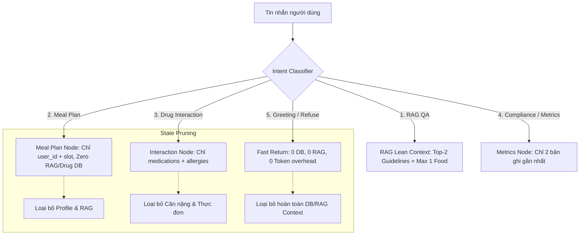

# HƯỚNG DẪN KỸ THUẬT TRIỆT TIÊU PHÌNH CONTEXT & DYNAMIC TOOL BINDING (ZERO-BLOAT CONTEXT)

> **Dự án:** P-014 AI Nutrition & Lifestyle Agent for T2D & Chronic Patients  
> **Phiên bản:** 1.0 (Giai đoạn 4 — Modular Skills Architecture)  
> **Module liên quan:** `app.agents.nodes.rag_tool`, `app.agents.skills.registry`, `app.agents.graph`, `app.agents.streaming`

---

## 1. TỔNG QUAN VẤN ĐỀ PHÌNH CONTEXT (CONTEXT BLOAT)

Trong các hệ thống AI Agent đa tác vụ, **Phình Context** là một trong những nguyên nhân hàng đầu gây suy giảm chất lượng câu trả lời:
1. **Lãng phí Token & Độ trễ cao (High Latency):** Nạp toàn bộ lịch sử chỉ số sức khỏe, danh sách món ăn, toàn bộ cơ sở dữ liệu và 11 chunks RAG vào mỗi lượt chat làm tăng kích thước prompt lên 3.000–5.000 token không cần thiết.
2. **Hiện tượng "Lost in the Middle":** Khi LLM phải đọc quá nhiều tài liệu tham khảo rườm rà, thông tin y khoa quan trọng bị chìm khuất, dẫn đến câu trả lời thiếu trọng tâm hoặc ảo giác (hallucination).
3. **Gọi Tool chéo tràn lan (Cross-Tool Bloat):** Bệnh nhân chỉ hỏi xem thực đơn hôm nay, nhưng agent lại chạy ngầm cả kiểm tra tương tác thuốc và truy vấn Vector DB Qdrant.

---

## 2. 4 GIẢI PHÁP TRIỆT TIÊU CONTEXT BLOAT TRONG GIAI ĐOẠN 4



---

## 3. CẮT GIẢM RAG CHUNKS TRONG `rag_tool.py`

| Tiêu chí | Phiên bản cũ (Legacy) | Phiên bản Giai đoạn 4 (Zero-Bloat) | Mức độ cải thiện |
|---|---|---|---|
| **Số lượng Guideline chunks** | `top_k=6` | `top_k=2` (tập trung) | Giảm **66.7%** |
| **Số lượng Food DB chunks** | `top_k=5` | `top_k=1` (khi hỏi món cụ thể) | Giảm **80.0%** |
| **Tổng số chunks nạp vào prompt** | **11 chunks** (~2.200 words) | **2–3 chunks** (~450 words) | Giảm **~75% token context** |
| **Context nạp vào LLM Prompt** | Toàn bộ 6 chunks đầu | Top-2 chunks tinh gọn nhất | Không còn hiện tượng *Lost in the middle* |

---

## 4. MA TRẬN STATE PRUNING THEO TỪNG SKILL / INTENT

Hàm `get_lean_state_for_intent(state, intent)` trong `app.agents.skills.registry` thực hiện cắt gọt State trước khi truyền vào từng node xử lý:

| Intent | Dữ liệu được GIỮ LẠI (Lean State) | Dữ liệu bị CẮT BỎ (Pruned Bloat) |
|---|---|---|
| **`meal_plan`** | `user_id`, `message`, `db` | Toàn bộ `profile`, `medications`, `allergies`, `rag_context`, `metrics_history` |
| **`interaction_check`** | `user_id`, `message`, `medications`, `allergies`, `db` | Lịch sử chỉ số cân nặng, BMI, mục tiêu calo, `rag_context`, thực đơn tuần |
| **`rag_qa`** | `message`, `profile: {disease, medications, allergies}` | `db` SQLAlchemy session, lịch sử cân nặng, thực đơn, nhật ký ăn uống |
| **`food_log`** | `user_id`, `db` | Toàn bộ `profile`, `medications`, `rag_context`, `metrics_history` |
| **`weekly_compliance`** | `user_id`, `db` | Toàn bộ `profile`, `medications`, `rag_context`, `meal_plan` |
| **`metrics_delta_advice`** | `user_id`, `db` | Toàn bộ `profile`, `rag_context`, `meal_plan`, `interactions` |
| **`doctor_note`** | `user_id`, `db` | Toàn bộ `profile`, `rag_context`, `interactions` |
| **`greeting`** / **`refuse`** | `message` | Toàn bộ DB, `profile`, `rag_context` (phản hồi tức thì) |
| **`unknown`** | `message`, `profile: {disease, medications}` | Toàn bộ DB session, thực đơn, lịch sử cân nặng |

---

## 5. ĐẢM BẢO TÍNH ĐỘC LẬP 1-1 (STRICT 1-1 ISOLATION)

Hệ thống tuân thủ nghiêm ngặt nguyên tắc **Độc lập 1-1**:
- Khi vào `meal_plan_node`: **TUYỆT ĐỐI KHÔNG** gọi vector search Qdrant và **TUYỆT ĐỐI KHÔNG** chạy rule engine tương tác thuốc.
- Khi vào `interaction_check_node`: **TUYỆT ĐỐI KHÔNG** load thực đơn tuần từ Postgres hay vector guidelines.
- Khi vào `greeting_node` / `refuse_node`: **TUYỆT ĐỐI KHÔNG** chạm vào Postgres DB hay Qdrant.

---

## 6. CƠ CHẾ DYNAMIC TOOL BINDING

Thay vì nạp toàn bộ 11 schema tools vào LLM cùng lúc (gây nhầm lẫn schema và tiêu tốn token), hệ thống cung cấp:
```python
schema = get_bound_tool_schema_for_intent("meal_plan")
```
Hàm này chỉ trích xuất duy nhất schema của tool `get_patient_meal_plan` để bind vào LLM call, giảm kích thước schema payload đi **hơn 90%**.
