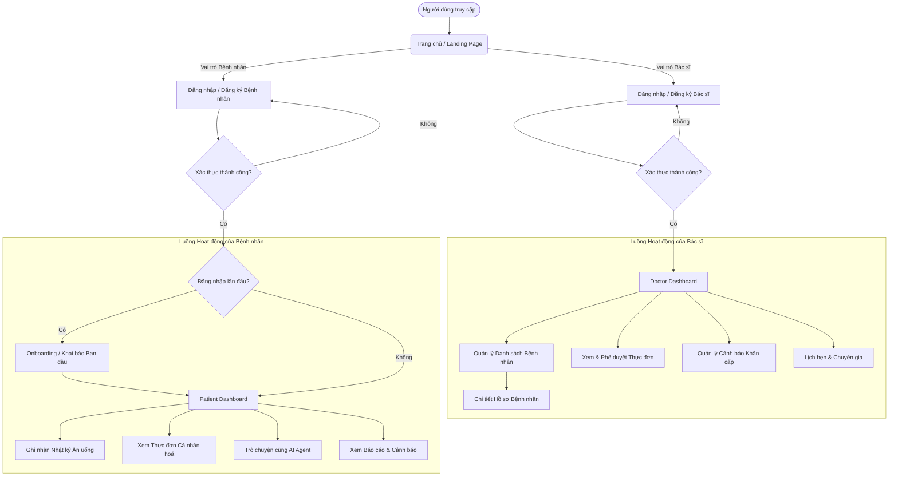

# Kiến trúc Định tuyến và Luồng hoạt động (Routing & Workflows)

Tài liệu này mô tả chi tiết toàn bộ các trang (routes) và luồng tương tác của người dùng trong hệ thống **NutriMed AI** sau khi được tái cấu trúc (Next.js 14 App Router).

---

## 1. Luồng Khách / Người dùng chưa đăng nhập (Public/Marketing Flow)
Luồng này dành cho người dùng mới truy cập vào nền tảng để tìm hiểu thông tin và chọn vai trò đăng nhập. Các route này nằm trong Route Group `(marketing)`.

- **`/` (Trang chủ / Landing Page):** 
  - **Chức năng:** Giới thiệu sản phẩm, tính năng cốt lõi (theo dõi tự động, cảnh báo realtime, thực đơn cá nhân hoá), cách hoạt động và lợi ích cho cả bệnh nhân lẫn chuyên gia y tế.
  - **Tương tác:** Có các nút Call-to-Action (CTA) để điều hướng người dùng tới trang đăng ký/đăng nhập tương ứng với vai trò của họ. Giao diện có Header và Footer tiếp thị độc lập.

---

## 2. Luồng Xác thực (Authentication Flow)
Được quản lý trong nhóm route `(auth)` với layout riêng biệt `app/(auth)/layout.tsx`, mang thiết kế tối giản, tập trung vào form điền thông tin, không chứa Sidebar hay Navigation phức tạp.

- **Dành cho Bác sĩ / Chuyên gia:**
  - **`/doctor/login`**: Trang đăng nhập cho bác sĩ.
  - **`/doctor/register`**: Trang đăng ký tài khoản cho bác sĩ mới.
- **Dành cho Bệnh nhân:**
  - **`/patient/login`**: Trang đăng nhập cho bệnh nhân.
  - **`/patient/register`**: Trang đăng ký tài khoản cho bệnh nhân mới.

---

## 3. Luồng Hoạt động của Bác sĩ (Doctor Workflow)
Sau khi bác sĩ đăng nhập thành công, hệ thống sẽ đưa vào giao diện nội bộ có chứa `DashboardShell` (gồm Sidebar và Topbar dành riêng cho bác sĩ).

- **`/doctor/dashboard` (Tổng quan):** 
  - **Chức năng:** Màn hình chính (Control Center). 
  - **Nội dung:** Hiển thị thẻ tóm tắt (số lượng bệnh nhân, thực đơn chờ duyệt, cảnh báo khẩn cấp), biểu đồ xu hướng đường huyết của nhóm bệnh nhân, danh sách cảnh báo cần can thiệp gấp và timeline lịch hẹn tư vấn trong ngày.
- **`/doctor/patients` (Danh sách bệnh nhân):** 
  - **Chức năng:** Xem và quản lý danh sách tất cả các bệnh nhân đang được bác sĩ theo dõi.
- **`/doctor/patients/[patientId]` (Chi tiết bệnh nhân):** 
  - **Chức năng:** Xem hồ sơ sức khoẻ chi tiết, lịch sử bệnh lý, độ tuân thủ, biểu đồ chuyên sâu và tình trạng hiện tại của một bệnh nhân cụ thể.
- **`/doctor/menus` (Thực đơn):** 
  - **Chức năng:** Xem, chỉnh sửa và phê duyệt các thực đơn do hệ thống AI hoặc chuyên gia dinh dưỡng gợi ý trước khi chuyển phát đến app của bệnh nhân.
- **`/doctor/warnings` (Cảnh báo):** 
  - **Chức năng:** Trung tâm quản lý toàn bộ các cảnh báo bất thường từ bệnh nhân (ví dụ: đường huyết tăng cao liên tục, bỏ bữa nhiều ngày) để kịp thời liên hệ hoặc điều chỉnh phác đồ.
- **`/doctor/dietitian` (Chuyên gia dinh dưỡng):** 
  - **Chức năng:** Trạm liên lạc để bác sĩ quản lý, tương tác hoặc hội chẩn với mạng lưới các chuyên gia dinh dưỡng khác trong hệ thống.
- **`/doctor/profile` (Hồ sơ bác sĩ):** 
  - **Chức năng:** Cập nhật thông tin cá nhân, chuyên môn, kinh nghiệm, quản lý cài đặt tài khoản và đăng xuất.

---

## 4. Luồng Hoạt động của Bệnh nhân (Patient Workflow)
Sau khi bệnh nhân đăng nhập thành công, hệ thống điều hướng vào giao diện có chứa `DashboardShell` dành riêng cho bệnh nhân.

- **`/patient/onboarding` (Hướng dẫn / Khảo sát ban đầu):** 
  - **Chức năng:** Luồng thiết lập ban đầu bắt buộc đối với bệnh nhân mới. Bệnh nhân điền các thông tin về thể trạng, bệnh lý nền (VD: Tiểu đường Type 2), dị ứng, sở thích ăn uống để AI sinh ra phác đồ dinh dưỡng ban đầu.
- **`/patient/dashboard` (Tổng quan):** 
  - **Chức năng:** Bảng điều khiển sinh hoạt hàng ngày. 
  - **Nội dung:** Báo cáo nhanh lượng Calo và Macro (Đường, Đạm, Muối) đã tiêu thụ so với mục tiêu; theo dõi tiến độ hoàn thành các bữa ăn trong ngày và các cảnh báo sức khỏe mới nhất từ hệ thống.
- **`/patient/food-log` (Nhật ký ăn uống):** 
  - **Chức năng:** Nơi bệnh nhân nhập (log) thực tế các bữa ăn hàng ngày. Hỗ trợ nhập liệu qua text hoặc upload hình ảnh để AI tự động phân tích định lượng dinh dưỡng.
- **`/patient/meal-plan` (Thực đơn của tôi):** 
  - **Chức năng:** Hiển thị chi tiết thực đơn cá nhân hoá được AI gợi ý và bác sĩ phê duyệt cho ngày/tuần hiện tại, kèm hướng dẫn chuẩn bị bữa ăn.
- **`/patient/chat` (Trò chuyện cùng AI):** 
  - **Chức năng:** Giao diện tương tác với Trợ lý ảo AI (NutriAgent) 24/7. Bệnh nhân có thể hỏi đáp về kiến thức dinh dưỡng, yêu cầu thay thế món ăn không thích, hoặc khai báo nhanh một triệu chứng bất thường.
- **`/patient/alerts` (Cảnh báo sức khoẻ):** 
  - **Chức năng:** Hộp thư chứa toàn bộ các lời khuyên, nhắc nhở hoặc cảnh báo tự động từ AI (VD: "Đường huyết tăng nhẹ") hoặc tin nhắn từ bác sĩ quản lý.
- **`/patient/reports` (Báo cáo):** 
  - **Chức năng:** Báo cáo chi tiết dạng biểu đồ về xu hướng sức khoẻ (đường huyết, huyết áp, cân nặng, mức độ tuân thủ thực đơn) theo thời gian tuần/tháng.
- **`/patient/profile` (Hồ sơ bệnh nhân):** 
  - **Chức năng:** Cập nhật thông tin cá nhân, mục tiêu sức khoẻ thay đổi, cập nhật tình trạng bệnh lý, quản lý cài đặt ứng dụng và đăng xuất.

---

## 5. Tóm tắt kiến trúc hệ thống
- **Tái sử dụng UI:** Toàn bộ giao diện Bác sĩ và Bệnh nhân được đóng gói dùng chung một "Shell" kiến trúc (`DashboardShell.tsx`). Việc này đảm bảo tính nhất quán tuyệt đối về Font chữ, hệ màu sắc (Design Tokens), Micro-animations và Responsive UI.
- **Khả năng Mở rộng API (Service Layer):** Hệ thống Data hiện tại đã được bọc qua một lớp mock (Services Layer). Trong tương lai, việc đấu nối với Backend thật (như Python FastAPI/Nodejs) sẽ rất minh bạch, chỉ cần thay thế các hàm `get()` bằng lệnh fetch/axios thực tế mà không phải thay đổi cấu trúc cây UI (React Components).

---

## 6. Sơ đồ Luồng hoạt động (Flowcharts)

### Tổng quan luồng điều hướng của hệ thống

