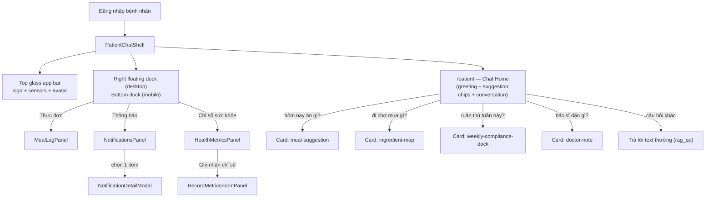

# Redesign giao diện Bệnh nhân — Chatbot làm trung tâm (Tổng quan)

> Đọc [`CLAUDE.md`](../../CLAUDE.md) và [`AGENTS.md`](../../AGENTS.md) trước. Tài liệu này bổ sung cho `tasks/roadmap-mvp.md`, chỉ tác động tới **frontend bệnh nhân** (`frontend/app/patient/**`) và các phần backend cần thiết để nuôi giao diện mới. **Không đụng `frontend/app/doctor/**`.**

## 1. Bối cảnh & mục tiêu

Giao diện bệnh nhân hiện tại là dạng "app cứng": sidebar trái cố định 6 mục (Trang chủ, Trợ lý AI, Thực đơn, Thông báo, Chỉ số sức khỏe, Hồ sơ), mỗi mục là 1 trang riêng biệt. Trợ lý AI (`/patient/assistant`) chỉ là 1 mục ngang hàng, không phải trung tâm.

Mục tiêu redesign: lấy **chatbot làm trung tâm** trải nghiệm bệnh nhân — sau khi đăng nhập, bệnh nhân luôn ở màn hình chat (giống mockup `chat-home`), có thể hỏi–đáp mọi thứ qua chat, các chức năng còn lại (thực đơn, thông báo, chỉ số sức khỏe) truy cập qua 1 dock nổi 3 nút bên phải (desktop) / đáy màn hình (mobile), hiển thị dạng panel trượt trên nền chat — **không mất chức năng nào hiện có**, chỉ đổi kiến trúc điều hướng và giao diện.

Nguồn thiết kế mới: `ui/stitch_vmec_10_health_assistant/**` (10 mockup HTML, xem mục 3).

**Nguyên tắc vàng (kế thừa `CLAUDE.md` mục "Nguyên tắc vàng"):** ưu tiên 1 luồng demo mượt hơn là nhiều tính năng dở dang. Redesign chia 3 giai đoạn độc lập, mỗi giai đoạn phải để lại app ở trạng thái build/run được, không crash.

## 2. Phạm vi & ranh giới

- **Trong phạm vi:** `frontend/app/patient/**`, `frontend/components/patient/**` (và component chia sẻ mới `frontend/components/patient-chat/**`), phần `frontend/components/shared/AppShell.tsx` (chỉ thêm nhánh rẽ theo role, không đổi hành vi khi `role === "doctor"`), `frontend/tailwind.config.ts` (chỉ *thêm* token mới), và ở Giai đoạn 2: `backend/app/agents/**`, `backend/app/api/v1/**`, `contracts/*.md` liên quan tới các intent/endpoint mới phục vụ bệnh nhân.
- **Ngoài phạm vi:** `frontend/app/doctor/**`, `frontend/components/doctor/**`, `frontend/components/shared/Sidebar.tsx`/`TopBar.tsx` hành vi cho role `doctor`, mọi logic auth/JWT, DB migration ngoài nhu cầu trực tiếp của các intent mới.
- Áp dụng đúng luật cứng `CLAUDE.md` mục 7: mọi số liệu dinh dưỡng AI trả về phải có citation; guardrails không đổi thuốc/liều; sửa `contracts/` trước khi đổi schema Agent/API.

## 3. Mapping mockup → tính năng → nơi hiển thị trong app mới

Toàn bộ mockup nằm ở `ui/stitch_vmec_10_health_assistant/<tên>/code.html` (kèm `screen.png` để xem trực quan). Bảng ánh xạ:

- **`chat-home`** → Trang chủ mới `/patient` (thay hẳn dashboard cũ ở `app/patient/page.tsx`). Top app bar kính mờ (glass) + avatar greeting + 4 chip gợi ý + input chat đáy màn hình. Dock 3 nút nổi bên phải (desktop) xuất hiện xuyên suốt mọi state của trang chat.
- **`meal-suggestion`** → Generative-UI card **trong bong bóng trả lời của chat** khi bệnh nhân hỏi "hôm nay ăn gì / thực đơn hôm nay" — slider ngang các món theo bữa (Sáng/Trưa/Tối), mỗi card có kcal + tag dinh dưỡng. Đã có phần lõi dữ liệu ở `mealPreview` trong `app/patient/assistant/page.tsx` hiện tại — tái dùng, chỉ restyle.
- **`ingredient-map`** → Generative-UI card trong chat khi hỏi "danh sách đi chợ / mua nguyên liệu ở đâu" — card bản đồ + danh sách điểm bán gần nhất. **Không có backend hiện có** — mock ở Giai đoạn 1, cân nhắc nguồn dữ liệu thật ở Giai đoạn 2 (mục 6).
- **`weekly-compliance-dock`** → Generative-UI card trong chat khi hỏi "tuân thủ của tôi tuần này thế nào" — line chart % tuân thủ theo ngày (T2–CN) + legend + nút "Xem báo cáo chi tiết".
- **`doctor-note`** → Generative-UI card trong chat khi hỏi "bác sĩ dặn gì / lời nhắc bác sĩ" — bento card avatar bác sĩ + quote + tag cảnh báo (ví dụ "Hạn chế muối", "Tái khám 2 tuần").
- **`meal-log-action`** → Panel trượt phải khi bấm nút **"Thực đơn"** trên dock: mini chart tuân thủ tuần + danh sách 3 bữa hôm nay với action "Ăn đúng"/"Ăn khác" (đã có logic tương đương ở `FoodLogModal.tsx` + trang `/patient/meals` — tái dùng).
- **`notification-list`** → Panel trượt phải khi bấm nút **"Thông báo"**: danh sách rút gọn (đã có logic đầy đủ ở `/patient/notifications/page.tsx` — tái dùng, đóng gói lại thành nội dung panel).
- **`notification-detail`** → Modal trung tâm mở ra khi bấm vào 1 thông báo trong panel trên: tiêu đề, nội dung đầy đủ, action "Đóng" / "Xem thực đơn tuần mới".
- **`health-metrics-dock`** → Panel trượt phải khi bấm nút **"Chỉ số sức khỏe"**: sparkline đường huyết 7 ngày, vòng tròn % tuân thủ phác đồ, 2 thẻ Cân nặng/Huyết áp, nút "Ghi nhận chỉ số".
- **`record-metrics-form`** → Cùng panel trên, chuyển sang view form khi bấm "Ghi nhận chỉ số": input Cân nặng/Huyết áp/Đường huyết + nút "Lưu chỉ số" (đã có logic ở `/patient/history/page.tsx` — tái dùng).
- **`design-system`** (thư mục trống hoặc chỉ chứa token) → chỉ dùng để đối chiếu token màu/spacing/typography khi setup Tailwind ở Giai đoạn 1.

## 4. Kiến trúc mới

Các panel (`MealLogPanel`, `NotificationsPanel`, `HealthMetricsPanel`, ...) được quản lý bởi 1 context chung `PatientPanelProvider` — cho phép mở/đóng, chuyển view (list→detail, dock→form) mà **không rời khỏi trang chat** (chat luôn ở dưới, panel nổi lên trên, giữ đúng tinh thần "chatbot là trung tâm").

**Nguyên tắc kỹ thuật quan trọng:**
- `frontend/components/shared/AppShell.tsx` thêm rẽ nhánh: `role === "patient"` → bọc bằng `PatientChatShell` mới; `role === "doctor"` → giữ nguyên `Sidebar` + layout cũ, không đổi gì.
- Không sửa `frontend/components/shared/Sidebar.tsx` cho phần dùng bởi doctor; nếu cần tách logic dùng chung (ví dụ `SidebarFooter`/logout), chỉ export thêm, không đổi hành vi cũ.
- Token thiết kế mới (`text-primary`, `text-secondary`, `glass-surface`, `emerald-ring`, ...) từ mockup **được thêm mới** vào `tailwind.config.ts`, không sửa/xoá token cũ (`on-surface`, `primary #006857`, ...) vì doctor UI đang phụ thuộc token cũ.

## 5. Ba giai đoạn — tổng quan

| Giai đoạn | Mục tiêu | Phạm vi | Tiêu chí hoàn thành | File chi tiết |
|---|---|---|---|---|
| **1 — UI shell + mock data** | Toàn bộ giao diện bệnh nhân theo mockup mới, mọi nút bấm được, dữ liệu có thể là mock cho phần chưa có backend | FE only (`frontend/**`), không đổi backend | Click hết luồng mô tả trong mục 3 không lỗi console, responsive desktop+mobile, doctor UI không đổi | [`01-phase1-ui-shell-mockdata.md`](01-phase1-ui-shell-mockdata.md) |
| **2 — Tái sử dụng & nâng cấp backend** | Thay mock bằng dữ liệu thật; thêm intent backend còn thiếu (đi chợ, tuân thủ tuần, ghi chú bác sĩ) bằng cách tái dùng tối đa code cũ | FE (gọi API thật) + BE1 (`agents/`) + BE2 (`api/`, `schemas/`) + `contracts/*.md` | Tất cả panel/card dùng API thật; `pytest backend/tests/` pass; contract cập nhật trước code | [`02-phase2-backend-integration.md`](02-phase2-backend-integration.md) |
| **3 — Dọn code thừa** | Loại bỏ trang/route/component cũ không còn dùng, tránh trùng lặp logic | FE (chủ yếu), rà soát chéo BE nếu có endpoint tạm ở giai đoạn 1 | `npm run build` sạch, không còn import chết, không còn keyword-match tạm | [`03-phase3-cleanup.md`](03-phase3-cleanup.md) |

Gợi ý phân công theo vai trò hiện có (`tasks/be1-ai-core.md`, `tasks/be2-platform.md`, `tasks/fe-frontend.md`): Giai đoạn 1 chủ yếu FE; Giai đoạn 2 cần FE + BE1 (intent mới trong `agents/`) + BE2 (endpoint/schema mới trong `api/`/`schemas/`); Giai đoạn 3 chủ yếu FE dọn dẹp, BE dọn phần tạm nếu có.

## 6. Gap dữ liệu đã biết (quan trọng cho Giai đoạn 2)

Từ khảo sát `backend/app/agents/nodes/intent_classifier.py`, `backend/app/agents/graph.py`, `frontend/lib/api.ts`:

- Backend **đã có** và tái dùng được: `run_agent`/`build_graph` (intents `meal_plan|interaction_check|food_log|rag_qa|refuse|unknown`), `POST/GET /food-log`, `POST /metrics` + `GET /metrics/history`, `GET/POST /notifications*`, `GET /meal-plans/me|schedule|{id}`.
- Backend **chưa có**:
  - Danh sách đi chợ / gợi ý điểm bán (không có bản đồ thật, không có bảng nguyên liệu tách biệt khỏi món ăn).
  - Endpoint **patient tự xem** tổng hợp tuân thủ tuần (hiện chỉ có `GET /doctor/patients/{id}/compliance` — góc nhìn bác sĩ xem bệnh nhân).
  - "Ghi chú/lời nhắc bác sĩ" dạng nội dung tự do gắn với 1 bệnh nhân cụ thể (gần nhất là notification `manual_reminder` do bác sĩ gửi qua `POST /doctor/patients/{id}/compliance/remind`, hoặc `adjustment_note` trên meal plan).

Chi tiết cách xử lý từng gap này nằm trong [`02-phase2-backend-integration.md`](02-phase2-backend-integration.md) mục 3.

## 7. Rủi ro & lưu ý

- **Xung đột design token:** mockup dùng namespace token khác hoàn toàn tailwind hiện tại (ví dụ `text-primary` mockup = `#141b2b` trong khi codebase hiện tại dùng `on-surface` cho vai trò tương tự). Phải thêm token mới bên cạnh, kiểm tra kỹ không trùng tên với token cũ đang được doctor UI dùng.
- **2 luồng chat song song tạm thời ở Giai đoạn 1:** trang `/patient` mới (chat-home) sẽ tạm dùng "keyword match" ở FE để giả lập 3 loại card chưa có intent thật (`ingredient-map`, `weekly-compliance-dock`, `doctor-note`), song song với luồng chat thật hiện có (`meal_plan/interaction_check/food_log/rag_qa`). Phải gắn cờ/log rõ ràng (comment `// TODO(phase2)`) để không quên dọn ở Giai đoạn 3.
- **Không phá luồng demo North Star hiện tại** (`tasks/roadmap-mvp.md` mục "North Star demo flow"): mọi bước sinh thực đơn, duyệt bác sĩ, xem thực đơn, nhận Compliance Notification vẫn phải hoạt động xuyên suốt 3 giai đoạn.
- **Mobile-first cho panel:** mockup thiết kế panel trượt phải cho desktop và bottom-sheet/bottom-nav cho mobile (`meal-log-action`, `doctor-note` mockup có `BottomNavBar` riêng) — không bỏ qua kiểm thử mobile.
