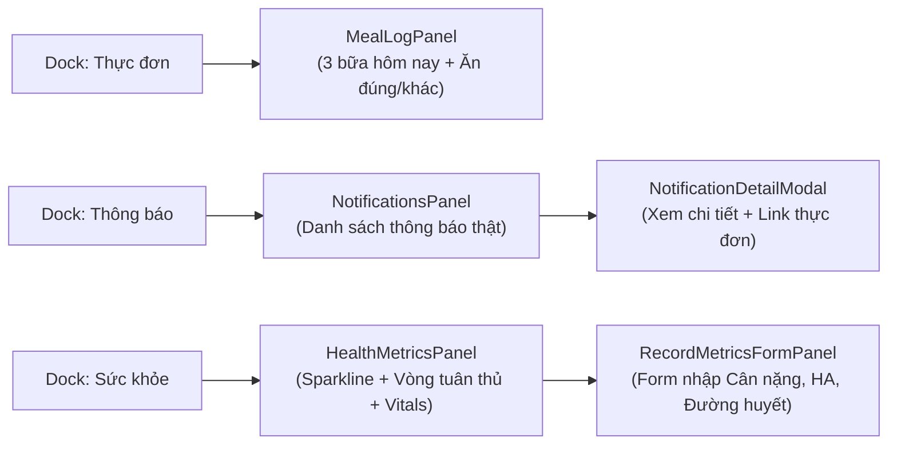

# Task 1.12–1.14 — Xây dựng 3 Side Panels Trượt (Nối API Thật)

> **Thư mục:** [`tasks/patient-chat-redesign/phase-1/`](README.md)  
> **Phụ thuộc:** Hoàn thành [`task-2-chat-shell-and-appshell.md`](task-2-chat-shell-and-appshell.md) và [`task-4-generative-cards.md`](task-4-generative-cards.md).

---

## 1. Mục tiêu
Xây dựng 3 Side Panels trượt từ cạnh phải (Desktop) hoặc Bottom Sheet (Mobile) được kích hoạt bởi Dock 3 nút. Toàn bộ 3 Panel này **kết nối trực tiếp với API backend thật đã có sẵn**.

---

## 2. Danh sách File tác động

- **[NEW]** `frontend/components/patient-chat/panels/MealLogPanel.tsx` (T1.12)
- **[NEW]** `frontend/components/patient-chat/panels/NotificationsPanel.tsx` (T1.13)
- **[NEW]** `frontend/components/patient-chat/panels/NotificationDetailModal.tsx` (T1.13)
- **[NEW]** `frontend/components/patient-chat/panels/HealthMetricsPanel.tsx` (T1.14)
- **[NEW]** `frontend/components/patient-chat/panels/RecordMetricsFormPanel.tsx` (T1.14)

---

## 3. Hướng dẫn chi tiết từng Panel

### T1.12 — `MealLogPanel` (Panel "Thực đơn")
- **Tham chiếu mockup:** `ui/stitch_vmec_10_health_assistant/meal-log-action/code.html`
- **Kết nối API thật:**
  - `api.getMyMealPlan()`: Lấy thực đơn tuần hiện tại -> Trích xuất 3 bữa (Sáng, Trưa, Tối) của **hôm nay**.
  - `api.listFoodLogs()`: Lấy trạng thái check-in hôm nay (đã ăn món nào chưa).
  - `api.createFoodLog({ meal_plan_id, slot, type: "as_planned" | "custom", note })`: Khi bấm "Ăn đúng" hoặc "Ăn khác".
- **UI:**
  - Cột trượt phải `fixed inset-y-0 right-0 w-full md:w-[480px] bg-white/95 backdrop-blur-2xl shadow-2xl z-50 animate-in slide-in-from-right duration-300`.
  - Header: "Ghi nhận tuân thủ" + nút đóng `closePanel()`.
  - Biểu đồ cột mini 7 ngày tuân thủ (T2–CN).
  - Danh sách 3 bữa hôm nay:
    - Thumbnail ảnh món + Thời điểm bữa ăn ("Bữa sáng", "Bữa trưa", "Bữa tối") + Tên món.
    - Nếu đã ghi nhận -> Badge xanh "Đã ghi nhận" (icon `check_circle`).
    - Nếu chưa ghi nhận -> 2 nút: `Ăn đúng` (`bg-[#006857] text-white`) và `Ăn khác` (mở nhanh prompt/modal ghi chú).

---

### T1.13 — `NotificationsPanel` & `NotificationDetailModal`
- **Tham chiếu mockup:** `ui/stitch_vmec_10_health_assistant/notification-list/code.html` và `notification-detail/code.html`
- **Kết nối API thật:**
  - `api.listNotifications()`: Lấy danh sách thông báo của bệnh nhân.
  - `api.markNotificationRead(id)`: Đánh dấu đã đọc.
  - `api.markNotificationDone(id)`: Đánh dấu hoàn thành.
- **UI `NotificationsPanel`:**
  - Cột trượt phải hiển thị danh sách các thông báo theo thời gian.
  - Mỗi item: Dot màu phân loại (Xanh: kế hoạch duyệt, Vàng: nhắc nhở, Đỏ: cảnh báo), Tiêu đề, Thời gian tương đối ("2 phút trước", "1 giờ trước").
  - Click vào item -> Gọi `openNotificationDetail(id)`.
- **UI `NotificationDetailModal`:**
  - Modal trung tâm với backdrop mờ (`fixed inset-0 z-[100] flex items-center justify-center`).
  - Tiêu đề thông báo, Nguồn phát ("Hệ thống điều trị VMEC"), Nội dung chi tiết.
  - 2 Action Buttons:
    - "Đóng" -> Gọi `backToNotificationList()`.
    - "Xem thực đơn tuần mới" (nếu là thông báo duyệt thực đơn `type === "plan_approved"`) -> Điều hướng tới thực đơn hoặc mở `MealLogPanel`.

---

### T1.14 — `HealthMetricsPanel` & `RecordMetricsFormPanel`
- **Tham chiếu mockup:** `ui/stitch_vmec_10_health_assistant/health-metrics-dock/code.html` và `record-metrics-form/code.html`
- **Kết nối API thật:**
  - `api.getMetricsHistory(90)`: Lấy chuỗi lịch sử chỉ số sức khỏe.
  - `api.recordMetrics({ weight, blood_pressure, blood_glucose })`: Lưu chỉ số mới vào DB.
- **UI `HealthMetricsPanel` (View: `dock`):**
  - Header: "Chỉ số sức khỏe" + Ngày hiện tại.
  - **Sparkline Đường huyết 7 ngày:** Đồ thị SVG xu hướng đường huyết với gradient xanh và các điểm tooltip.
  - **Vòng tròn Tuân thủ Phác đồ:** Progress circle SVG thể hiện % tuân thủ.
  - **2 Thẻ Vital:**
    - Cân nặng (kg) kèm badge trạng thái ("Ổn định").
    - Huyết áp (mmHg) kèm badge trạng thái ("Bình thường" / "Hơi cao").
  - Nút lớn phía dưới: "Ghi nhận chỉ số" -> Gọi `goToRecordMetricsForm()` để chuyển view.
- **UI `RecordMetricsFormPanel` (View: `record`):**
  - Cùng khung panel, header chuyển thành: "Ghi nhận chỉ số" + "Nhập thông số lâm sàng mới" + nút Back quay lại dock.
  - 3 Input số liệu lâm sàng:
    1. Cân nặng (kg) — placeholder `68.5`
    2. Huyết áp (mmHg) — placeholder `120/80`
    3. Đường huyết (mmol/L) — placeholder `5.6`
  - Nút "Lưu chỉ số": Gọi `api.recordMetrics(...)` -> Thành công -> Gọi `backToHealthDock()` và tự động nạp lại dữ liệu mới nhất.

---

## 4. Tiêu chí Hoàn thành
- [x] Bấm nút **"Thực đơn"** trên dock -> Panel mở ra, thấy đúng 3 bữa hôm nay, bấm "Ăn đúng" lưu thành công vào backend.
- [x] Bấm nút **"Thông báo"** trên dock -> Danh sách thông báo thật hiển thị, click 1 thông báo mở modal detail đầy đủ.
- [x] Bấm nút **"Chỉ số sức khỏe"** trên dock -> Hiển thị đúng biểu đồ và chỉ số gần nhất; bấm "Ghi nhận chỉ số" chuyển sang form, nhập số liệu và lưu thành công.

